Everyone knows that everyone bikes in Amsterdam.

Sure, they have the most bike lanes in the world, and it’s currently a national dilemma that the Dutch are running out of bike parking spaces. It’s a funny issue that of course the Europeans would have. However, until actually seeing what can only be called a bike infestation, I didn’t appreciate the scale to which people cycle in Amsterdam.

To my surprise, the only people in the city wearing helmets were the ridiculous looking Segway tourists, while everyone else speedily pedals past. I was amazed that more people didn’t get into accidents and hurt themselves, as within 10 minutes of being loaned a bike, I almost crippled a family of 3 (Mother pedaling, one child sitting in the front carriage, another facing backwards). In my defense, it took me until the last moment to realize there were no brakes; I had to pedal backwards to stop (a feature I didn’t realize still existed).

I like to think I don’t get culture shocked, but between the bikes, a language that sounds like someone angrily hitting a keyboard (I was staying at the intersection of Wenckebachweg Street and Duivendrechtsekade Avenue) and my first two meals being a pastrami, walnut, brie, and pickle sandwich followed by toast, butter and chocolate sprinklers for breakfast (a real classic called Hagelschlag), it suffices to say things here are a little bit different. Also, I was living in my friend Marit’s literal shipping container, which is their version of a student residence.

By day Marit was at school, and so I was left with my bike, named Stella, to explore the canals and markets of Amsterdam. Taking my time with every free cheese tasting I could find and eating an unhealthy amount of kibbeling (fried fish) and stroopwaffles, it was easy to explore the city by myself. By night, Marit got a few friends together to run around the famous ‘brown bars’, where they play awful Dutch music, serve your drink with an attitude and a pack of cards, and patrons smoke inside.

Overall, the Dutch are a wonderful people, though in a sea of 6 ft blondes, I definitely stuck out.

Speaking of which, after arriving back home Sunday and begrudgingly attending a Monday and Tuesday packed with class, I flew out to Ireland, where the only thing more plentiful than red hair is an early afternoon Guinness. Exploring Dublin was a ton of fun, especially after having some great spots pointed out from a free walking tour. Surprisingly, there are dozens of delicious burrito joints that have popped up around the city, with students passionately defending their favourites as the best.

During both day and night, Dublin is teeming with music, the majority being of the traditional, or ‘trad’ genre. While every song sounds almost the same (Irish bagpipes can only cater so many emotions), it was easy to appreciate the awesome talent of the musicians, and simple enough to dance to.

After having enough of my 36 person dorm room in Dublin, I hopped on the next bus out to the city of Galway to meet with a Couchsurfing host who agreed to take me in for a couple of nights. Although much smaller than Dublin, Galway is the epitome of the true Irish atmosphere, and to my delight the accents were as thick as could be.

Meeting a Finnish couple who were also staying with my host, we decided to adventure over to the nearby Cliffs of Moher and do the accompanied 3 hour hike from the tiny village of Doolin. For extra fun, we thought to hitchhike out there instead of the convenient bus. As my Finnish friends had never hitched before, I took on the self-appointed role as a “thumbs-out connoisseur”. With our ‘Doolin’ and ‘Galway’ pieces of cardboard ready for action, we hit the streets.

After 20 minutes of waiting under a bridge, we were picked up by a friendly middle aged woman who took us part way, and recounted her days as a youngster hitching around Europe. Our next driver was a gas station owner, who pitied us standing in the rain, taking us 5km over to the next town. Lastly, we were picked up by a friendly German tourist, Phil, who didn’t have anywhere in particular to be and thought it’d be hilarious to help us out.

Thank goodness for Phil – he took us the entire way, including the scenic route!

After arriving in Doolin, we started on our long hike (we walked over 30km in the end!) to reach the famous cliffs. With breathtaking views, some wonderful weather and the biggest rainbow I’ve ever seen pop up right beside our lunch spot, the day was a major success. Although we didn’t properly hitchhike back (we knocked on a tour bus door and asked for a lift), the Finns were satisfied with the adventure, and we all had a fantastic nap on the way back home.

As always, thanks for reading. Lots more to come!

Zev

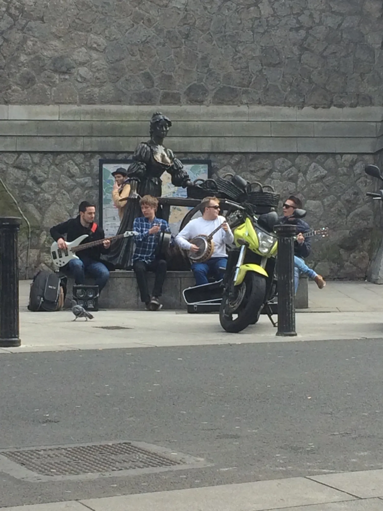{: w="1500" h="2000" }

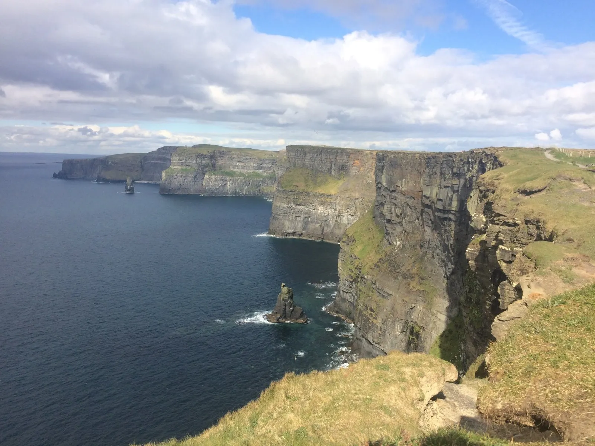{: w="1600" h="1200" }

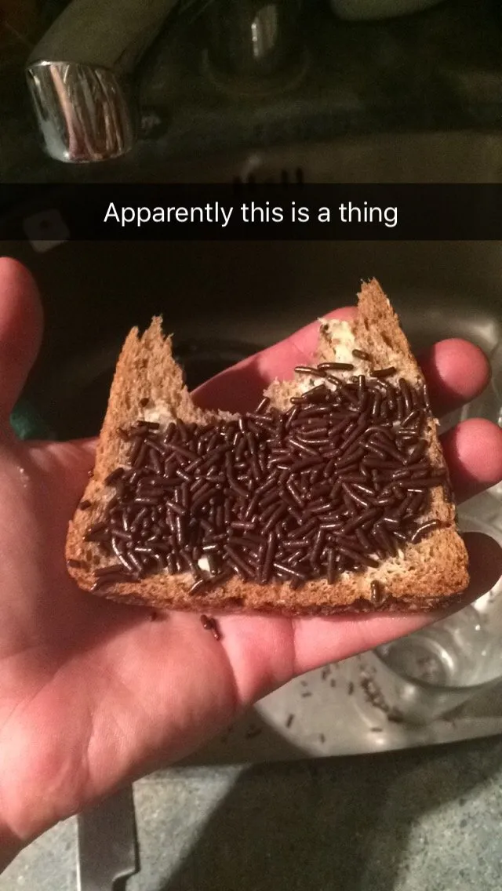{: w="640" h="1136" }

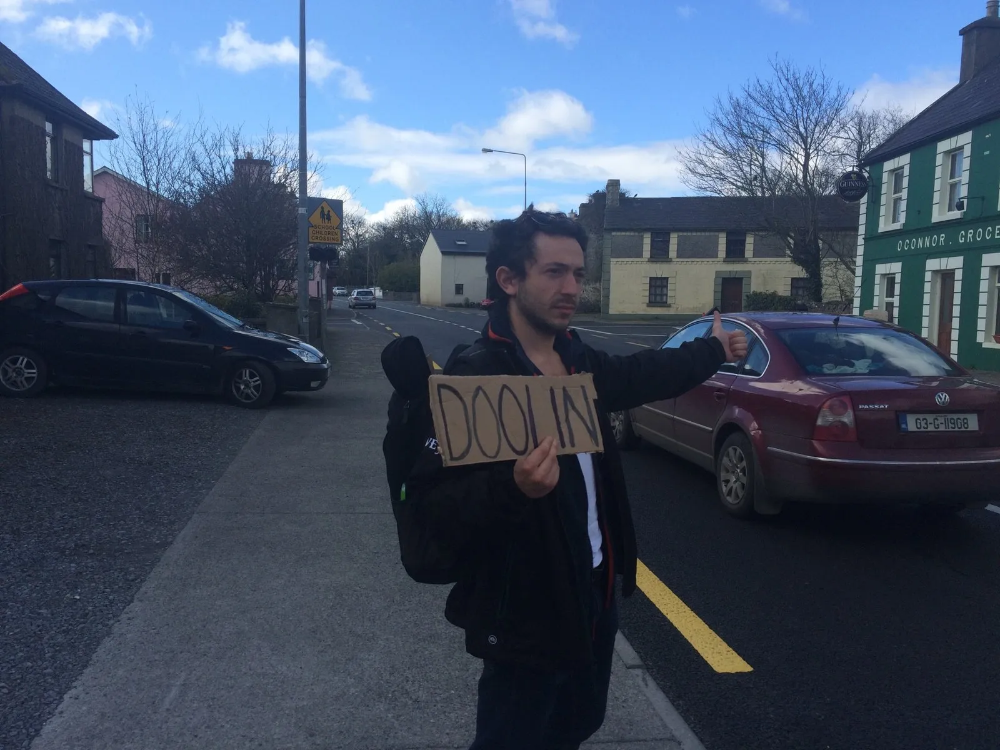{: w="1600" h="1200" }

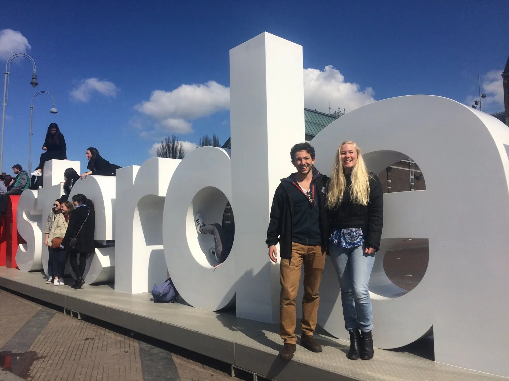{: w="1600" h="1200" }

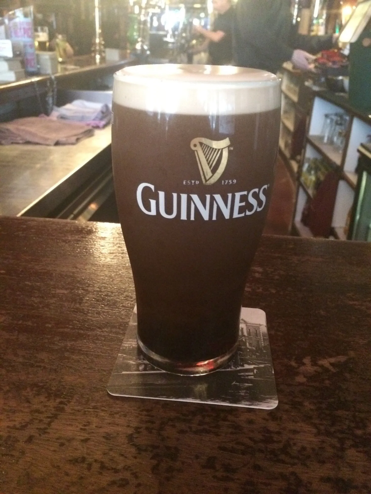{: w="1500" h="2000" }

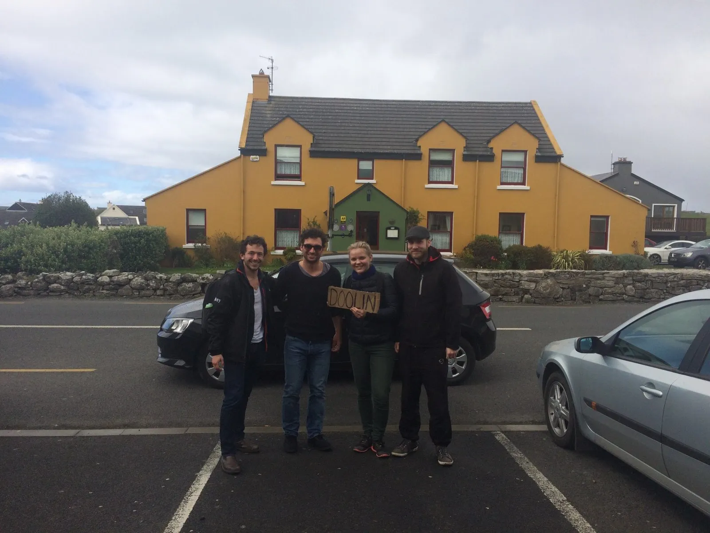{: w="1600" h="1200" }

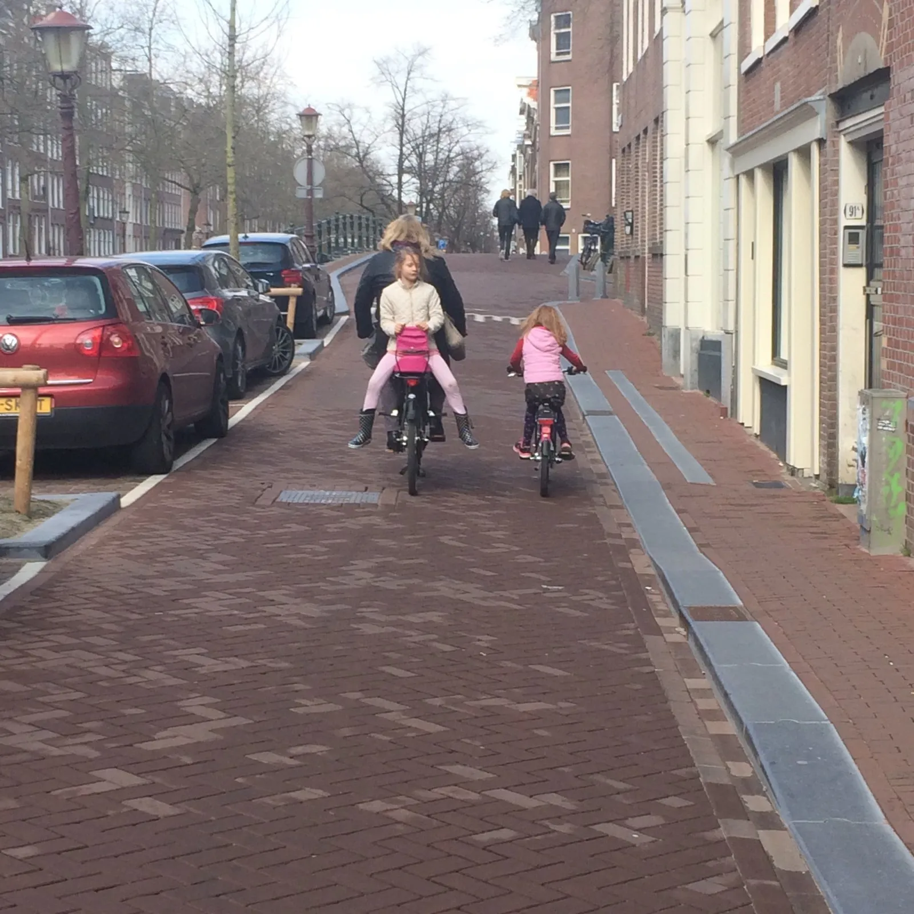{: w="1600" h="1600" }

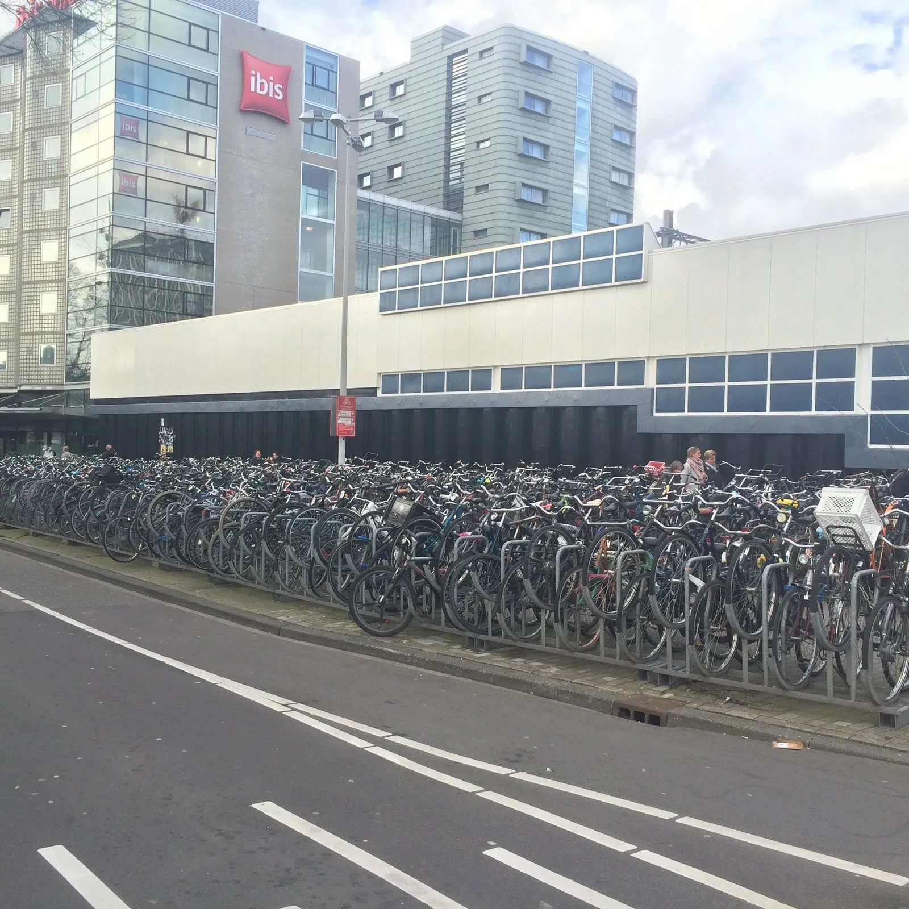{: w="1600" h="1600" }

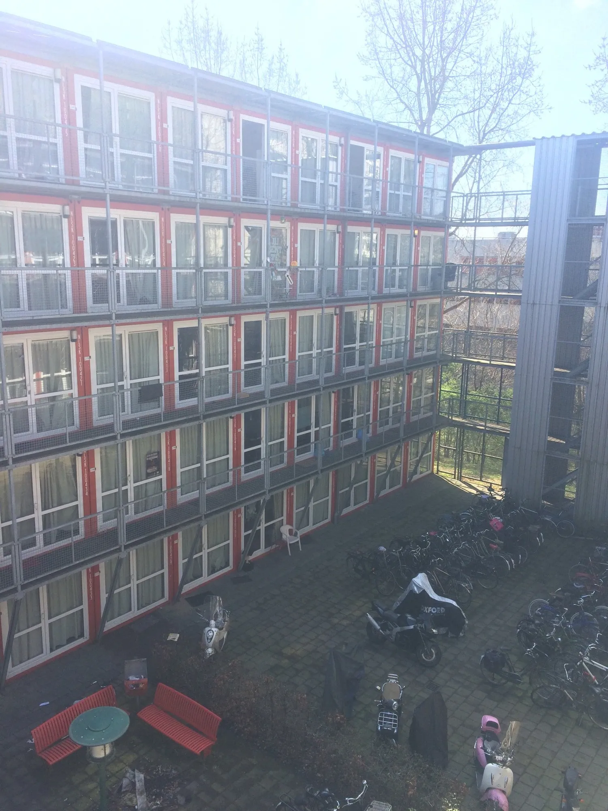{: w="1500" h="2000" }

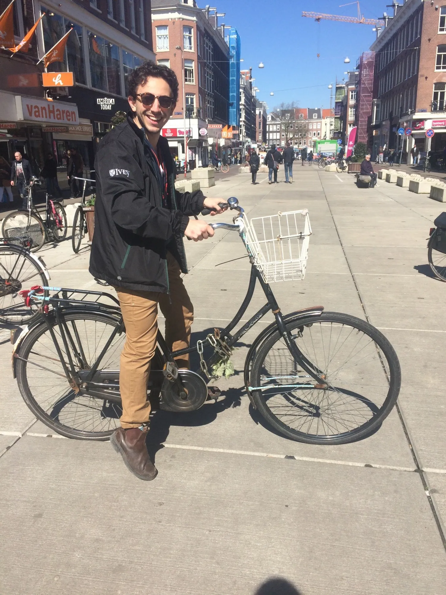{: w="1500" h="2000" }

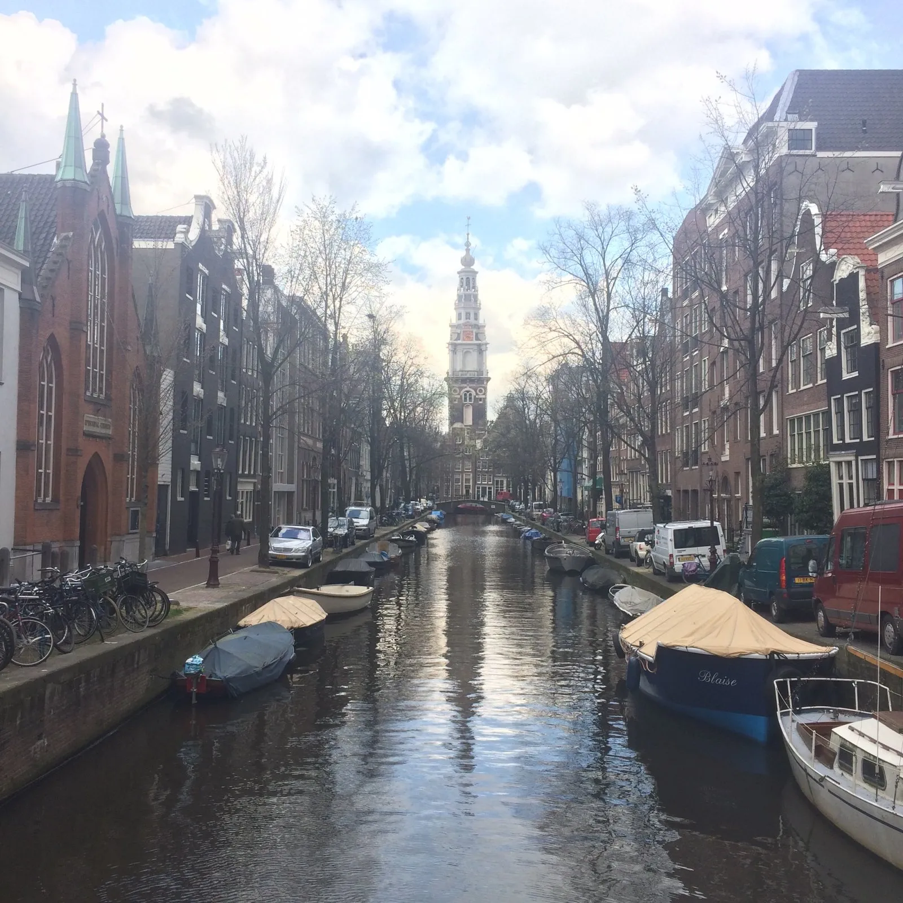{: w="1600" h="1600" }

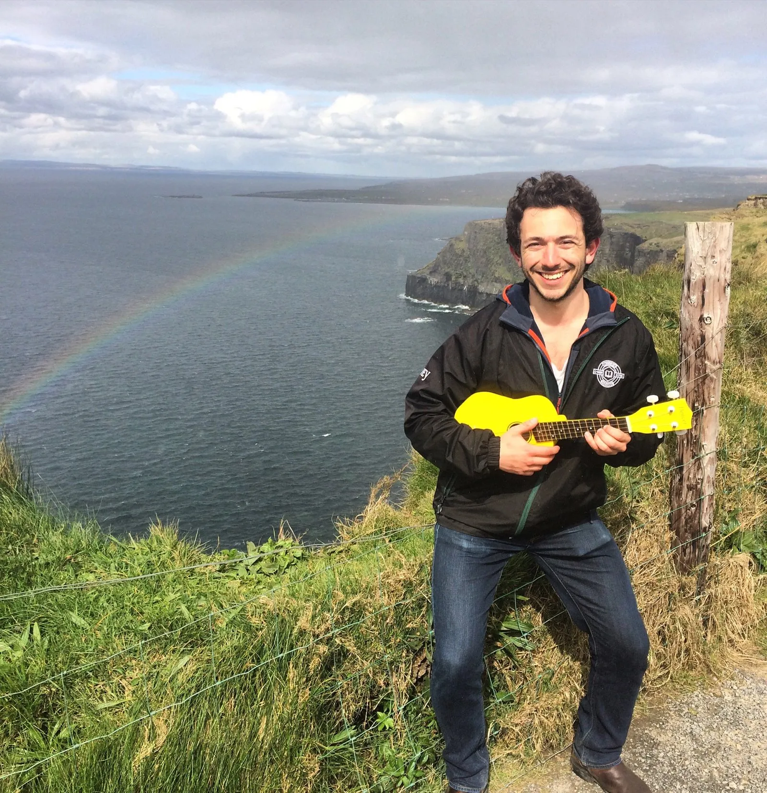{: w="1600" h="1654" }

