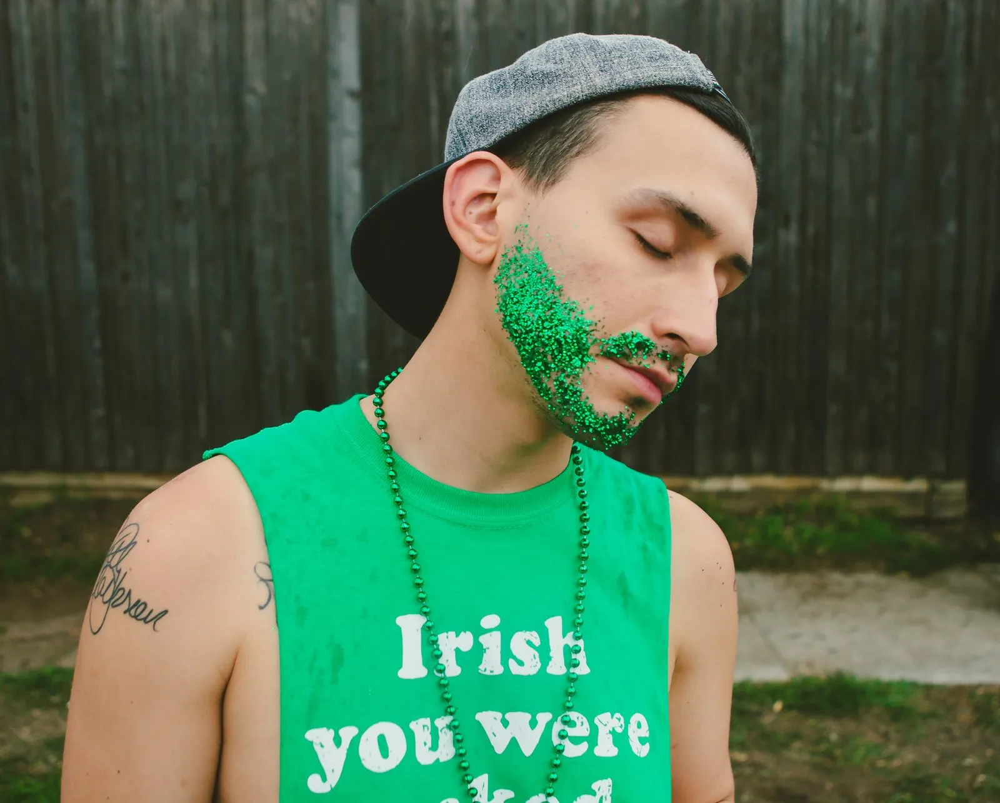
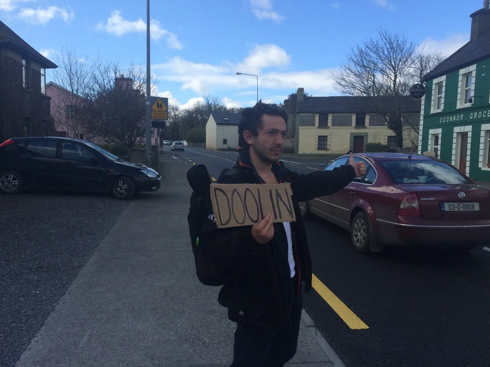
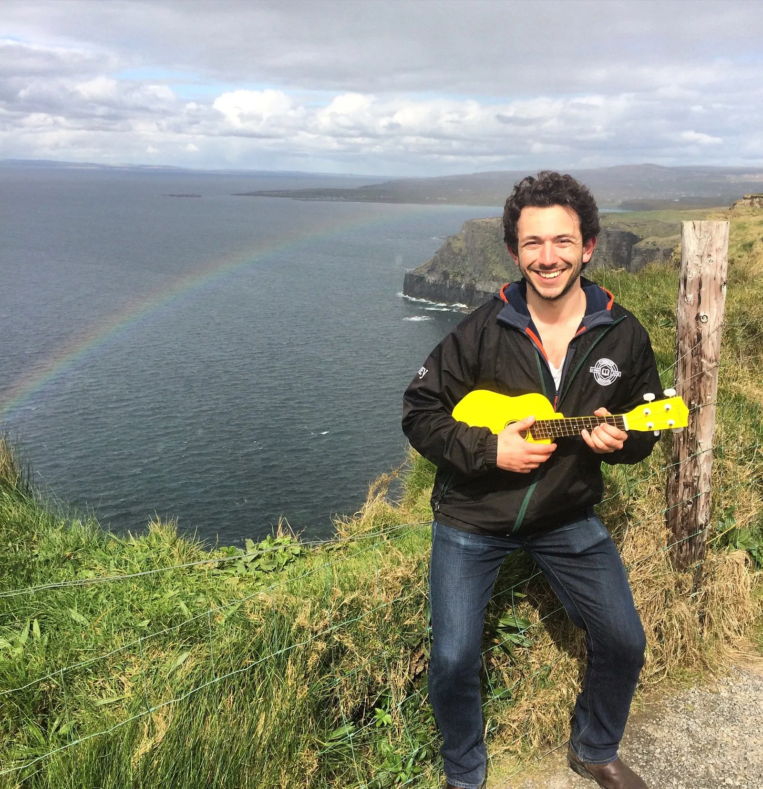
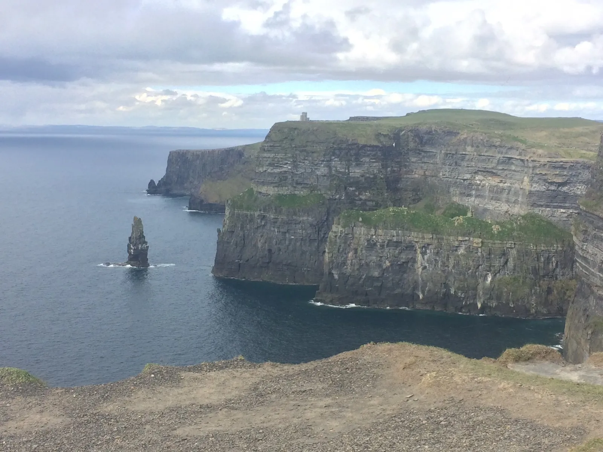

#### Dublin and Galway, Ireland

I saw a ton of red hair.

I drank a lot of Guinness.

But most importantly, I saw the end of not a single, but a double rainbow. And yes, I was as disappointed as you that there was neither a pot of gold, nor a leprechaun at the bottom of it.

Ireland’s a magical place filled with magical people. There’s not a place in the world where strangers are more keen for a story, a chat over a pint, or a dance to some trad (Irish folk music for those not familiar). It’s easy to make friends and stumble home with some memories. And that’s why I fell in love with the place.

Being on my exchange and living in Portugal, I packed my bags after finishing classes for the week on Tuesday. That left me with 5 days to stuff my face with potatoes and Guinness, and I wasn’t going to waste any of it.

Flying into Dublin with Ryanair, I was greeted at the airport by a surprisingly cheerful border agent. With a grin on his face, and a thick Irish accent, I was given an excessively large green passport stamp and let in to roam the country.

With explicit instructions on how to grab the bus into the city, my backpack and I slowly made our way into the heart of Dublin. Noticing the ‘Fresh Off A Plane in a New Country’ look of wonder on my face, an older woman with a playful lilt in her voice started chatting with me, asking where I was from and where I was off to. As we passed through the Dublin suburbs, she recounted a bit of Irish history and telling me what I should be getting up to while I was in town.

Eventually saying goodbye to the woman and her wonderful accent, I set on my merry way of checking into the hostel and exploring the city. As Ireland’s capital and most touristic city, there’s a lot of the city solely dedicated to foreigners.

On the walking tour I took (would highly recommend taking one, especially given the Northern and Southern Ireland divide and IRA history), it was quickly pointed out that you would not see many locals in an area called Temple Bar.

Temple Bar is in the heart of Dublin, and a ‘go-to’ place for tourists who want to drink some Irish drinks and dance some Irish jigs, with the caveat that it’s with a bunch of other foreigners. Our tour guide seemed to know the exact prices for a Guinness at every establishment we passed, and Temple Bar, although iconic, was overpriced and not the place to spend a whole night.

{: width="1600" height="1285" loading="lazy" }

Surprisingly not a local

Photo by [Matthew T Rader](https://unsplash.com/@matthew_t_rader?utm_source=unsplash&utm_medium=referral&utm_content=creditCopyText) on [Unsplash](https://unsplash.com/search/photos/irish-man?utm_source=unsplash&utm_medium=referral&utm_content=creditCopyText)

While I love live music and the area occasionally had some good bands, during the day it seemed that every Temple Bar pub I popped into played the exact same songs, over and over. I heard an acoustic version of Wonderwall no less than 7 times, which as every guitar player knows, is 7 times too many.

Something I found culturally beautiful, was that the Irish are so keen to have some fun that they even made up their own word for it. Going from bar to bar, a night consists of finding the best ‘craic’ (pronounced ‘crack’), which at it’s core means good laughs and good times.

While I was initially confused as to why all the Irish were looking for hard drugs, it turned out to be universally recognized in the country. Somehow it found it’s way into my vocab, and it really is a great word for representing a good night out.

After spending a couple of days in Dublin and eating some of the surprisingly good Mexican food found in the city (shout out to Boojum for an amazing burrito and great hot sauce selection), I bussed over to Galway, where I’d set up a couchsurfer to host me.

A happy little west coast town filled with great music and more Guinness, Galway was exactly what I was hoping Ireland would be. Less touristic than Dublin, it was great to get out of a big city and meet some Irish folk. Filling the day drinking in the park and listening to trad, Galway was the perfect getaway.

After meeting up with my couchsurfing host, I learned that she was also hosting a few more people. 5 to be exact, so it was definitely a full house. Unbeknownst to me, apparently my first evening I’d told a Finnish couple that was staying there that, I as a hitchhiking expert, and hitch with them over to the Cliffs of Moher.

While I barely had a recollection of the night, I thought the idea sounded like fun! So, the next morning we drew up some signs on cardboard and pitched our thumbs by the highway.

{: width="1600" height="1200" loading="lazy" }

A smile might have helped

As expected, it took some time for the three of us to get picked up, and no less than 3 separate cars for us to make it all the way. One friendly woman picked us up as she was going to work, recounting her days as a vagrant. A man at a gas station felt pity for us standing in the rain and took us a couple kilometres to the next gas station. Finally, a friendly German tourist named Phil drove us the rest of the way (taking the scenic route), we made it to the town of Doolin.

Dubbed the music capital of Ireland, sadly we weren’t there to take in any of the tunes. Instead, we set out on a 20km hike of Irish countryside, with the Cliffs of Moher waiting at the end.

Jumping over fences, walking alongside creeks, and getting stared down by angry looks bulls, we happily made our way along the 3 hour hike. Stopping on a grassy nook for some lunch, we were in prime location to have the biggest rainbow I’ve ever seen pop up right beside us. Excitedly admiring the natural wonder, we noticed that not only could we see the bottom of it, but it was actually a double rainbow!

So cool. Of course I had to snap a pic with the uke.

{: width="1600" height="1654" loading="lazy" }

They’re after me lucky charms!

Happy and fed, we kept on our walk until eventually making it to the legendary Cliffs. The rockface exceeded our expectations, and it felt well earned after a tiring hike. Walking along the trail and peering over the 400ft edge, we spent the next hour taking pictures and hanging out.

With the sun out and sky blue, there was an abundance of tourists who had bussed up to the cliffs that afternoon. I feel a busy place flush with stereotypical group tours tends to cheapen the beauty of whatever you’re looking at, but thankfully we had enough space to keep to our own.

{: width="1600" height="1200" loading="lazy" }

Just barely enough cliffs to go around

After taking our time on the cliffs, we realized we needed to somehow travel the 80km back to Galway. As the group’s self-proclaimed hitch-hiking connoisseur, the Finnish couple turned to me to figure out how we’d be getting home. Tired and not much in the mood to approach families in the car park, I figured that we might have better luck hitching back with one of the tour buses.

After a quick conversation with the workers in the Cliffs’ visitor’s center, they made a couple of calls to find out that a bus with some spare seats was leaving in a few minutes to go back to Galway. While we’d have to pay 10€, we thought that was a welcome alternative to trying our luck on a moonlit highway.

Tired, but feeling accomplished, we took up residence in the back of the bus, falling asleep to the driver’s voice calling out landmarks as we made our way back to the city.

My trip had all too quickly come to an end, and that Sunday I headed on back to Lisbon. With a newfound appreciation for Ireland, I knew I’d one day have to come back to explore more of the Gaelic country, and visit cities like Cork, Kilarney and Belfast.

Thankfully, I got out of Ireland what I went there to do. Drink until I was full of Guinness, dance a good trad jig, and find as much craic as I could fit into a week.

I wasn’t upset at having some delicious Mexican food either.

Until next time Ireland!
