Five months has very quickly come to an end. Sitting in the Marrakech airport (Morocco), waiting to go back to Portugal, I’m reflecting on the past half-year, and wondering how the hell I ended up in Africa.

Although sad to be leaving this side of the world in four days, I’m more nervous to be starting work in six. Still dumbfounded that anyone would give me the responsibility of a real world job, it’s an exciting new chapter to start, and I’ve already picked out my first day suit.

After finishing up my studies in Lisbon (I passed!), I decided to take a month off, with two weeks in the south of Spain and two weeks in Morocco. Nothing but an over sized backpack, bright yellow ukulele and a dwindling bank account.

In Spain I didn’t have much of an itinerary, but ended up hitting Cadiz, Ronda, Malaga, Granada and Madrid. Each city had its own bit of charm, from hitchhiker friendly drivers in Ronda, the excessive plates of **free** tapas in Granada (it came with every drink), or taking salsa lessons in Madrid.

Also notable was being adopted by the Puerto Rican population of southern Spain for a few days (20 some-odd people), who enjoyed my broken attempts at Spanish, and reciprocated with food, drink and incredible hospitality. Spain was great overall, but I missed the smiling shopkeepers in Portugal versus feeling like a burden to the Spanish businessmen. Suffice it to say, it’s still on the bucket list to learn Spanish, though, with my Duolingo luck (learning Brazilian Portuguese instead of European), I’ll probably end up speaking Catalan by accident.

Flying into Morocco, I had zero idea what I’d be seeing. Withholding New Balance running shoes with pulled up socks, I couldn’t have looked more touristy coming out of the airport.

Diving into a sea of hijabs and aggressive taxi drivers vying for my business, I had the instructions to ignore everyone and find the public bus. Within five minutes I’d already had a few new BFFs as evident by the cries of “20 euros, special price, just for you my friend!”.

Having finally found the bus and paid my 4 dirham (40 cents), I slowly acclimatized to the Moroccan world and had my first experience in the developing world.

Straight out of the seventies, a guy with a boombox over his shoulder hopped on, blasting reggae. An old man with a 90 year old smile slowly walked over, struggling with his cane and being ushered along by helpers offering their seats. I happened to strike up conversation with a man who was extremely excited at my Canadian origin, and he proceeded to lecture me on what to look out for and talked about his family. Thankfully he didn’t try and sell me on his uncle’s or brother’s hotel as came to be the norm – just a genuine guy!

Immediately, I figured out a few things about Morocco. Firstly, absolutely everything is haggle-able, whether it’s the set price on the menu or the price of the hostel. Although you may have to walk away more than once, you can usually name your price. Secondly, during Ramadan, things move a lot slower. 90% of the population is fasting during the day, only eating their iftar (read: breakfast) at sundown, followed by dinner at ~2:30am. No food, no water, and importantly in Morocco, no cigarettes. This can make some people reasonably irritable, and I learned to eat and drink as discreetly as possible. With lots of naps throughout the day, the country just barely manages to function. I have a massive newfound respect for the guides who took me on strenuous hikes and the farmers who continue to work throughout the month.

Two of my favourite African experiences happened in Essaouira, a tiny seaside town where tourists go for relaxation and fresh fish. The city’s mantra appeared to be “this is not Marrakech”, meaning they aren’t outright trying to rip you off by applying a tourist tax.

The city’s fish market was a bustle of activity, with hundreds of merchants with the day’s fresh catch displaying their fish and yelling at you to come and have a look, while little boys follow you around to buy their plastic bags. Although the market was deemed “tres cher” (very expensive) by an African woman I spoke with, I grabbed three beautiful red snappers for the equivalent of $10, which included the scaling and gutting of the fish.

We were told by our host to bring the fish to any restaurant or person on the street with a grill, and for $1 got the fish perfectly deep fried, with a squeeze of fresh lemon on the side. Accompanied by some avocados and Moroccan pizza, it was one of the best meals I’ve had to date.

After some amazing food, a few friends and I thought it’d be fun to get a little beauty treatment, and embrace one of the traditional aspects of Moroccan life; the hamam. A hamam is a form of hot bath and spa with the option to get a massage.

While sounding pleasantly innocent, anyone who has had one knows that the Hamam is anything but.

Upon entering the steam room, my four friends and I see grown men wearing nothing but tattered underwear, stretching and bathing. Before I could even assess what I should be doing, an obese mustachioed Moroccan with unreasonably small briefs grabs me by the ear and throws me to the floor. This is the beginning of my ‘massage’.

For the next 20 minutes, I’m subject to incredible positions including:

–          Me on my back, him on top of me

–          Me grabbing his foot with one leg behind his head

–          In a full nelson position with him cracking my neck in both directions really quickly

–          Him cracking my ears (I didn’t know you could do that)

–          Flipping me over by picking up half my body and throwing me

Following each maneuver, he would gingerly slap the massaged area and laugh to himself. I wish I had photos.

This activity was not for the faint of heart, but I found myself giggling at the absurdity of the situation more than a few times. During the ‘massage’, I was passed off to a skinny fellow with scratchy pads on his hands, who used the soap I gave him to do a thorough, full body scrub.

Proceeding the cleaning, the big guy alternated between throwing buckets of scalding hot and then frigidly cold water on me, chuckling all the while. I’m not sure that the cold water was a norm for the locals, as the masseuse was having way too much fun dumping it on me.

My friends and I were surprised that after the beating / hamam, we felt better than ever and lighter than air. With hygiene being a relatively low priority as a backpacker (we live by the smell test), I felt cleaner than I can describe, and stretched out like a yogi. Although intimidating, without a doubt I’d recommend hamam-ing, even if it’s just to tell the story after.

If you’ve made it this far, thank you so much for reading! I sincerely appreciate it, and have loved receiving your responses / feedback and hearing about some of the places you’ve travelled to, alongside life updates. If work proves to be interesting enough, I’ll see about continuing the newsletter, subject to the thoroughness of my NDA.

Until next time,

Zev

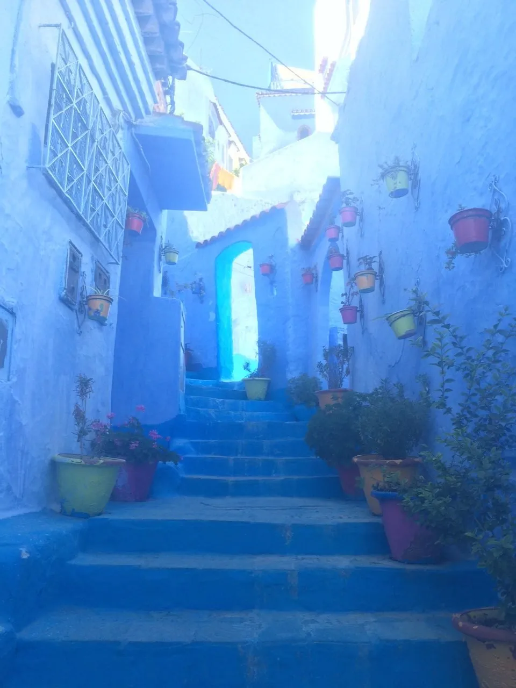{: width="960" height="1280" loading="lazy" }

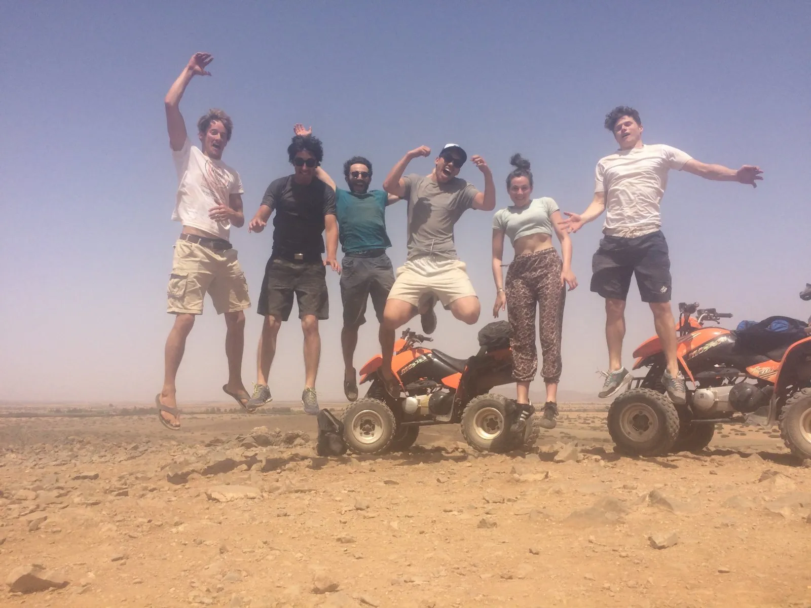{: width="1600" height="1200" loading="lazy" }

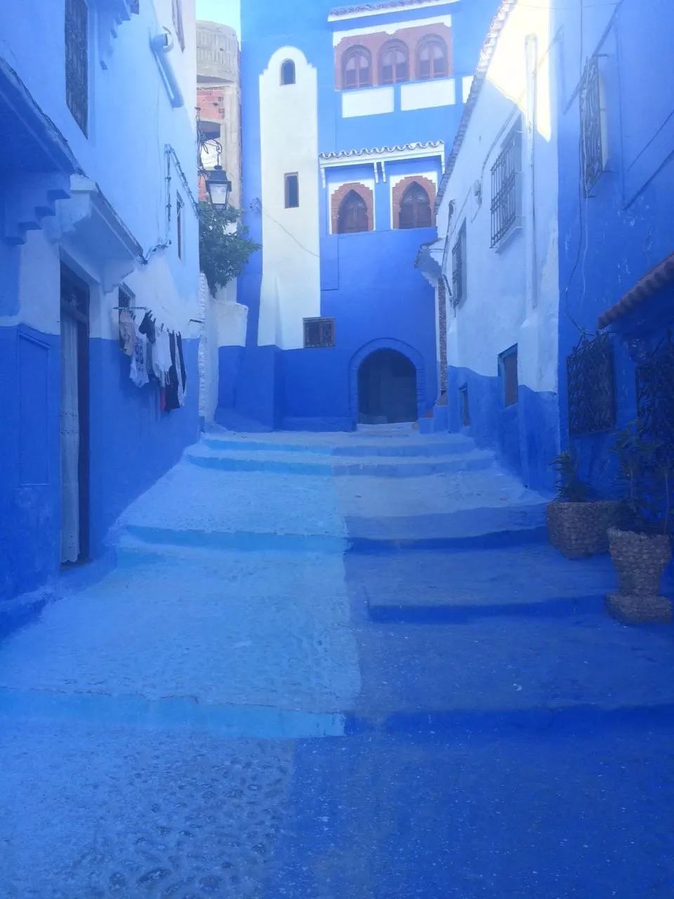{: width="960" height="1280" loading="lazy" }

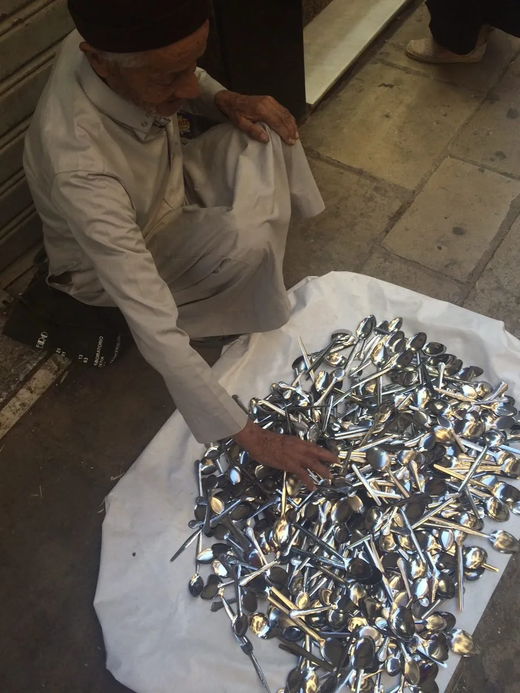{: width="960" height="1280" loading="lazy" }

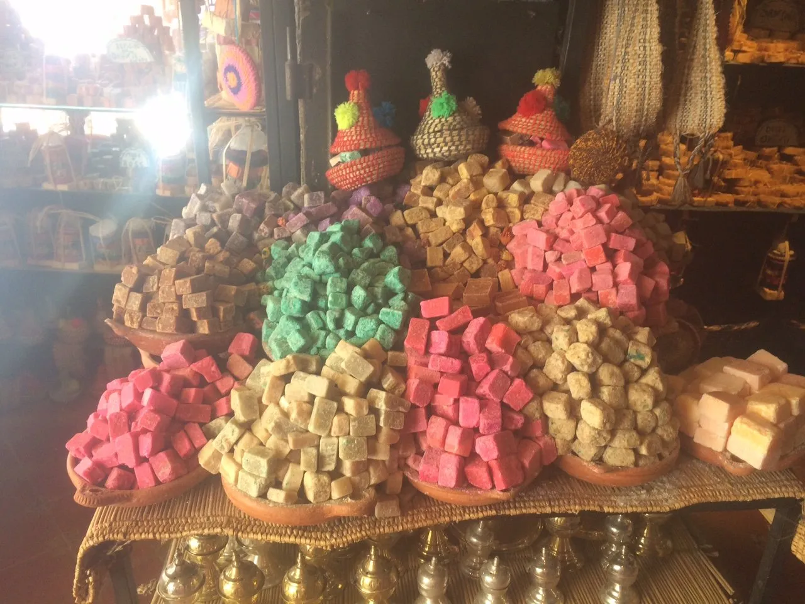{: width="1280" height="960" loading="lazy" }

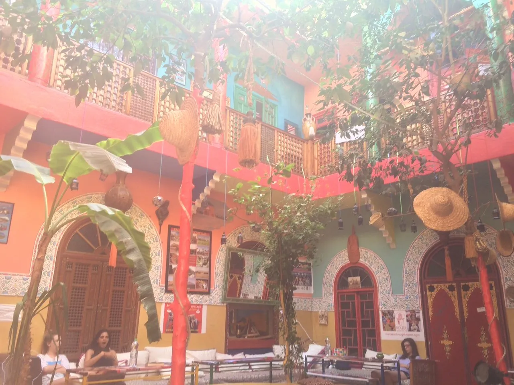{: width="1280" height="960" loading="lazy" }

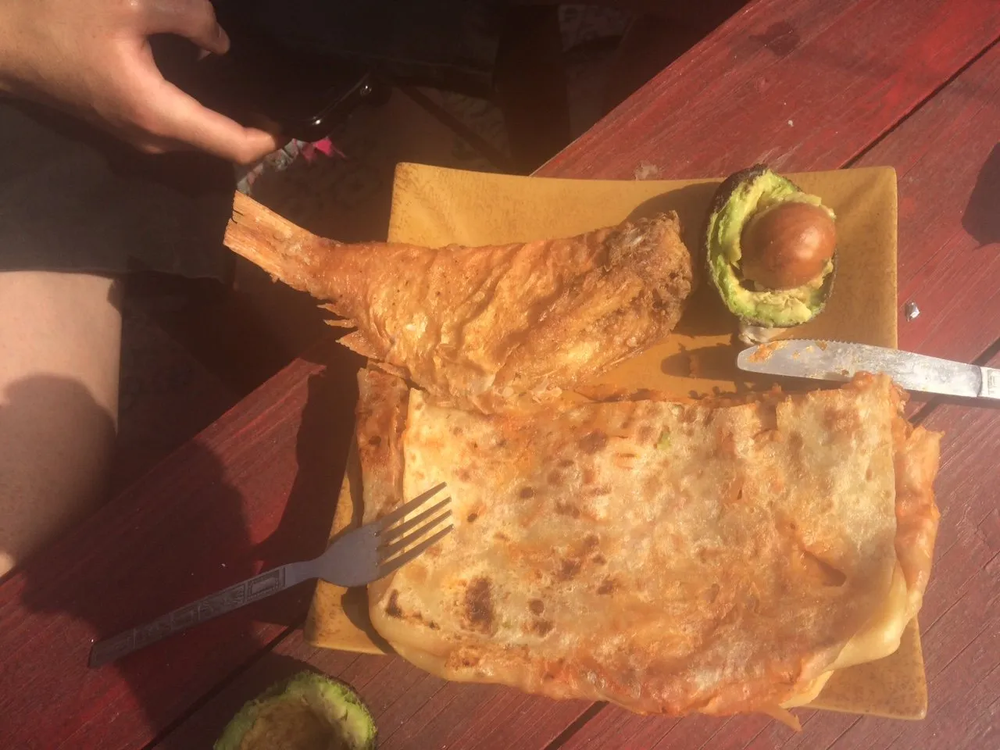{: width="1280" height="960" loading="lazy" }

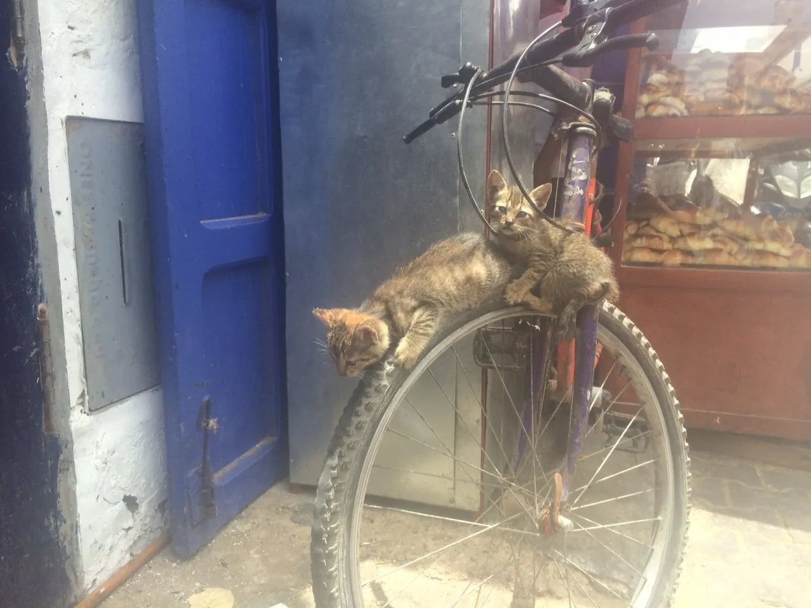{: width="1280" height="960" loading="lazy" }

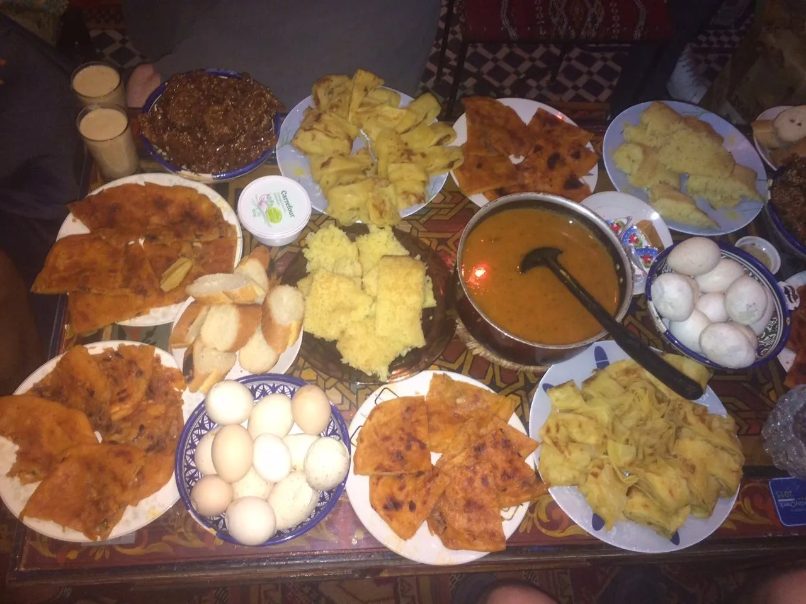{: width="1280" height="960" loading="lazy" }

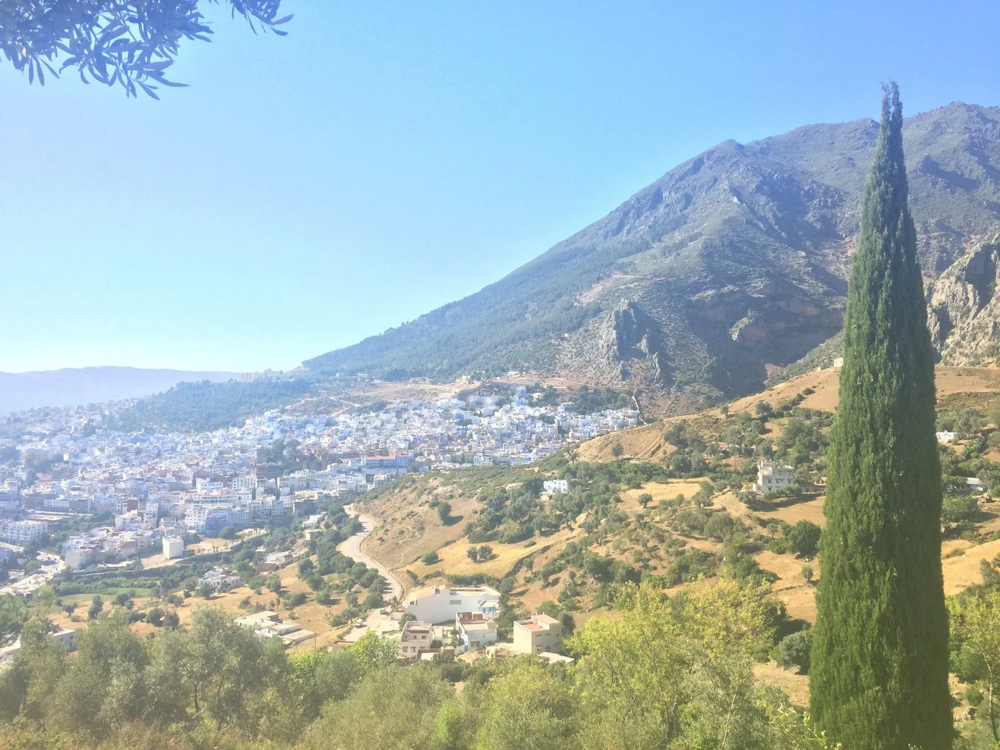{: width="1600" height="1200" loading="lazy" }

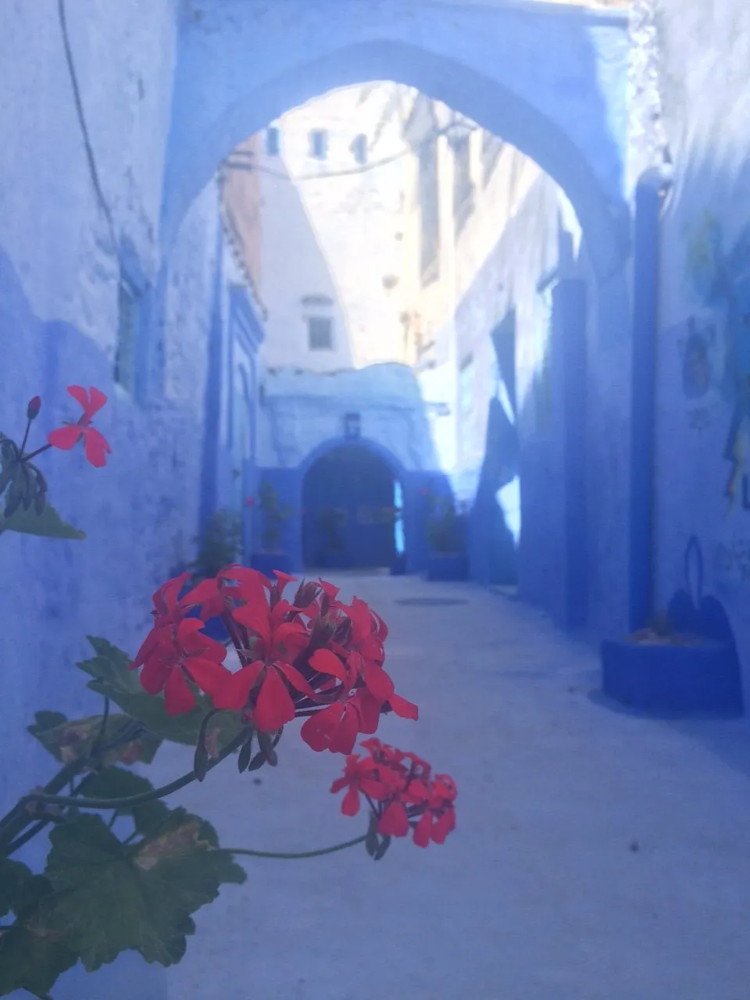{: width="960" height="1280" loading="lazy" }

