Oh how time flies.

It’s now been almost 10 months since I’ve moved down under, and I can’t believe how quickly this year has gone by.

While I’ve happily settled into my daily routine;

5am: Wake up to birds angrily chirping
5:25am: Rush to boxing class to get a black eye, a nosebleed, and a helluva sweat
9am: Hit the spreadsheets at work (pivot tables have become my best friend)
2pm: Schmooze with some colleagues
6pm: Drinks, dancing, or a BBQ
10pm: Pass out and repeat,

I still don’t really understand how I ended up here. So much has changed in what feels like only a few months! Thankfully I’ve had the opportunity to meet incredible people and make some great memories along the way.

Although I’ve spent the majority of my time exploring my new pad in Queensland, Australia, I had a surprise visit to make back home in December – my brother Zale decided to get married! While I had to FaceTime into the actual wedding in September, I made it in-person for the really important part, the party.

Held at a Chinese dumpling restaurant with a black tie-dye theme (i.e. grateful dead shirt meets oxford loafers), 45 hours in the air was well worth getting to celebrate with the new hubby and wife. Cramming in as much time with family and friends that I could, two weeks was perfect for a quick pop in and giving my much neglected winter sweaters some love.

After making it back to Aus from the party, I had the chance to check out Fraser Island, the world’s largest sand island. Spending Christmas surrounded by dingoes (wild dogs who occasionally eat children), 4WD driving on sand highways, some gorgeous landscapes and new friends, it was easy to understand why the aboriginals call the island ‘Paradise’, or K’gari in their language.

Exploring the deserts and freshwater lakes on the island were incredible, but unfortunately some of the wildlife was a bit too friendly.

As a friend and I made it back to our tent at 2am after some drinks, we were quick to notice a spider the size of a truck hanging out above her sleeping bag. The gale force winds and powerful thunder set a mighty stage for the battle that ensued over the next hour between us and the eight legged monstrosity that kept us from getting some sleep. Thankfully after some strategizing, we cornered the beast into a bowl and threw it into the night. You’re not eating me tonight, Spidey.

In other brief news, my folks came out to visit and I got to show them around Brisbane and try out all the fancy restaurants I can’t afford. Thanks Mom and Dad!

As another quick aside, in true Queenslander fashion I had my first skin check after finding an interesting looking freckle. After getting stripped and manhandled (would not recommend) by an overly friendly doctor, I can happily report that I am skin cancer free!

That’s all I have for now! As always, I’d love to hear from you on updates and things going on in your lives.

Drop me a line, or shoot me an email. Can’t wait to catch up.

Zev

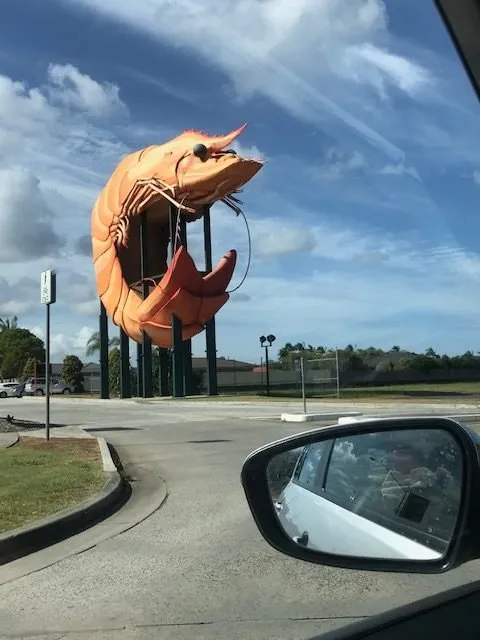{: w="480" h="640" }

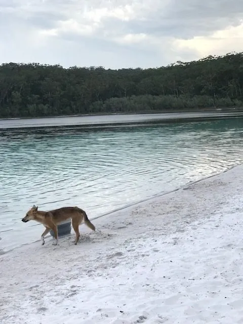{: w="480" h="640" }

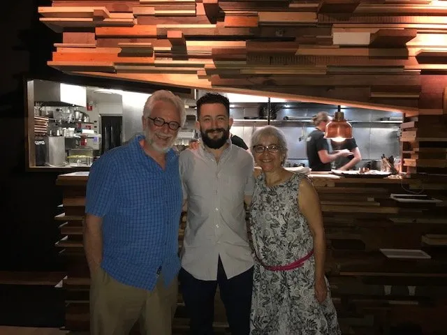{: w="640" h="480" }

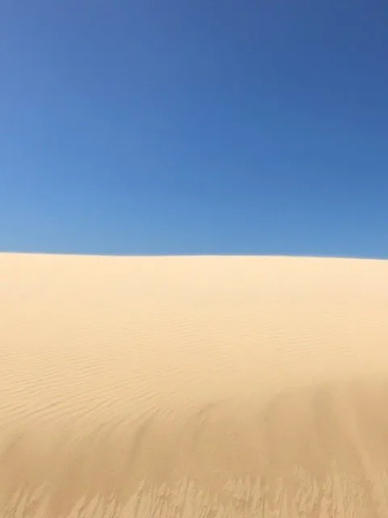{: w="480" h="640" }

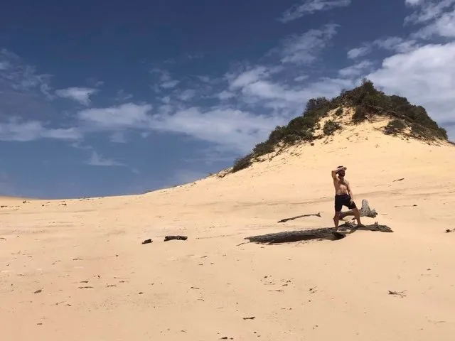{: w="640" h="480" }

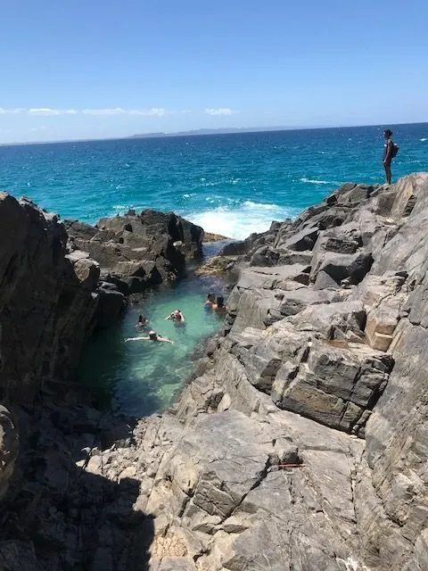{: w="480" h="640" }

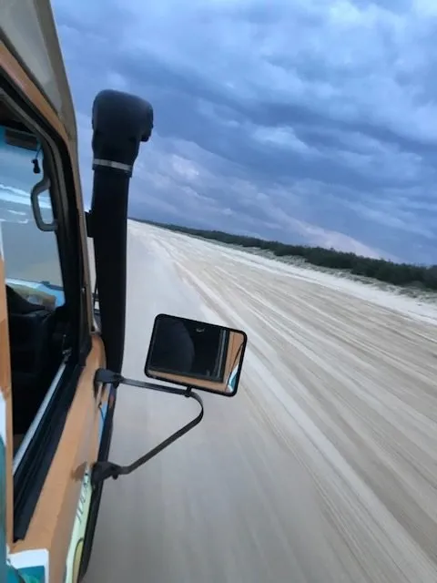{: w="480" h="640" }

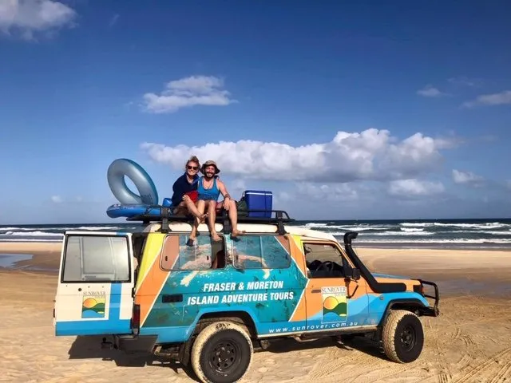{: w="640" h="480" }

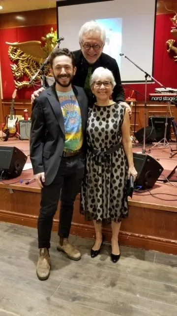{: w="360" h="640" }

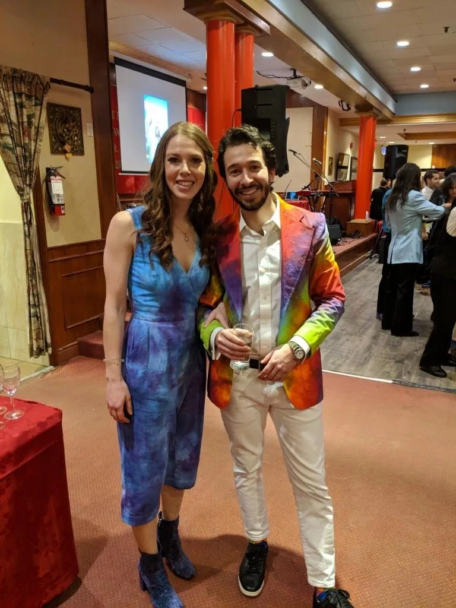{: w="768" h="1024" }

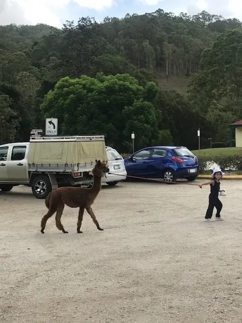{: w="480" h="640" }

