Potato curry, crab curry, dahl curry, chicken curry, green chili curry, sour fish curry…

In Sri Lanka, the food options are endless. And by endless, I mean you have one option, which is unsurprisingly curry. However, with a ton of different options and delicious roti and coconut sambol to accompany every meal, you never get a bored palette. However, it’s important to note that from landing in this country until leaving, your taste buds are in for a serious ride on the spicy train.

Choo choo baby.

A few months ago I had the chance to go on a two week tour of Sri Lanka, exploring the country alongside my Mom, Dad, brother and sister-in-law, Sammi. As it was an organized tour with Intrepid Travel, we had a few active geriatrics with us to get to know and chat with on our bus drive around the country. Being an official food tasting tour, we were chauffeured from house to house of Sri Lankan locals, who not only showed us their beautiful homes but also how they cook their meals.

Everything starts with the coconut. After opening the coconut and draining the water, using (usually) a sharp corner of a stool, it gets finely shredded into flakes. What took me 30 minutes of hacking away at half a coconut was eloquently done in 2 minutes by a Sri Lankan. Obviously I need some more practice. Or at the very least, an electric shredder.

These flakes are then used to make the first and second milk (what we know as coconut cream vs coconut milk), which is used as the base for most dishes. It doesn’t get more fresh, and the taste is phenomenal. However, this whole process involves intimately massaging the ingredients by hand, and I noticed a few worried looks from our group regarding the lack of hand washing. Welcome to the jungle!

Alongside food, our tour involved going on safari, exploring the markets and hiking up to some beautiful temples. While an organized tour isn’t what I would traditionally go for (a bit of a change from couchsurfing and hitchhiking), it was great to have someone else making the decisions for me and an awesome opportunity to hang out with the family while I’m living a bit of a stretch away.

Sri Lanka is an incredible place. Going into the trip, I barely knew anything about the country except for my impression that it was a smaller India. However, getting to meet the locals and experience the culture, I felt amazed that this place was not often talked about. What a treat.

Besides Sri Lanka, life in the upside down has continued on. It’s crazy to think I’ve been here in Australia for more than a year now. There’s been so many friends, random road trips, restaurants and amazing views that it’s tough to keep track.

For big life items, I’m hoping to start up a blog with some travel articles I’ve written. As well, I was thinking about opening up a granola manufacturing business. There’s a serious lack of decent oats in this country, and I would love to right that wrong. If anyone has any advice for either of those ventures, I’m all ears!

While so much has happened, my bucket list continues to grow. As a few friends from back home have done, please come and say hello! Would love to show you around, and of course, catch up over a cuppa. My treat.

Zev

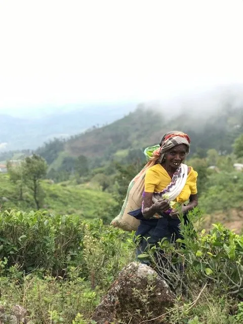{: width="480" height="640" loading="lazy" }

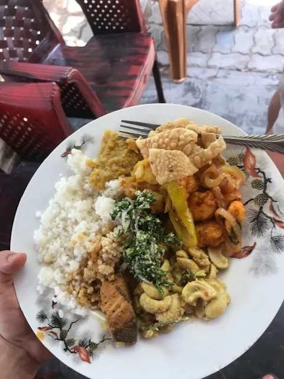{: width="480" height="640" loading="lazy" }

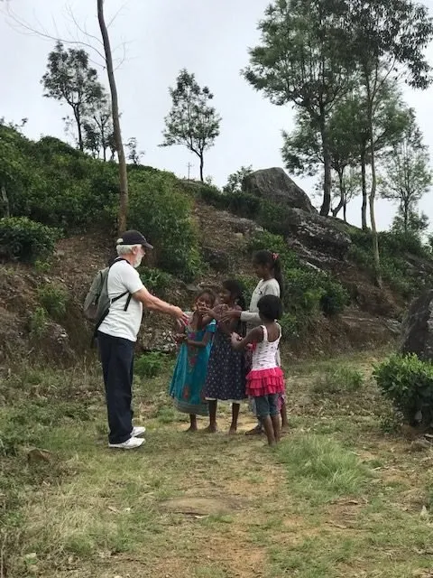{: width="480" height="640" loading="lazy" }

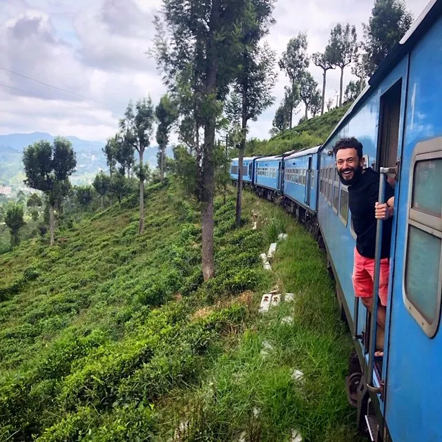{: width="640" height="640" loading="lazy" }

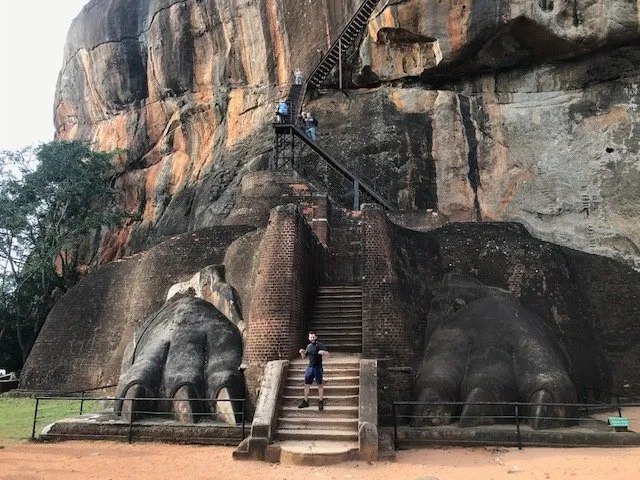{: width="640" height="480" loading="lazy" }

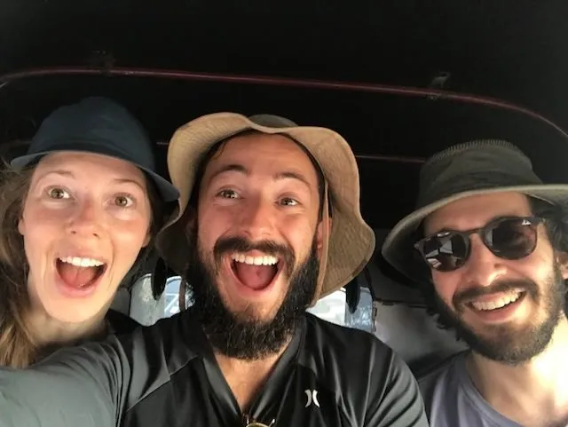{: width="640" height="481" loading="lazy" }

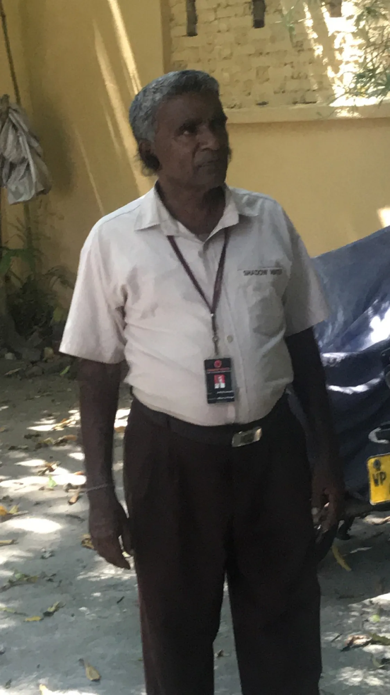{: width="1125" height="2000" loading="lazy" }

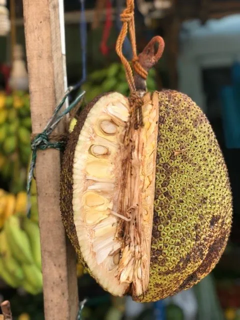{: width="480" height="640" loading="lazy" }

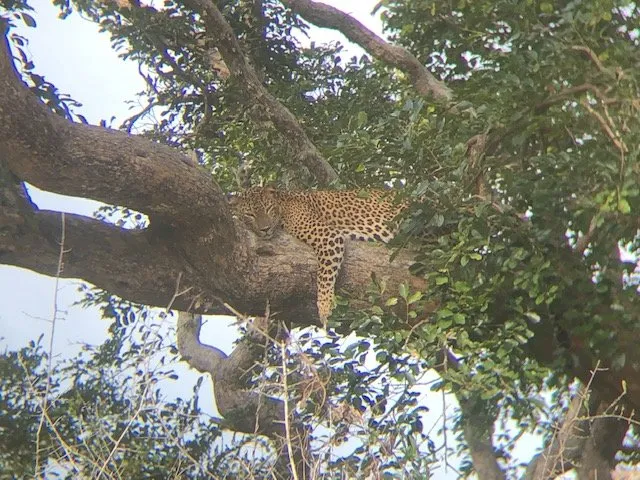{: width="640" height="480" loading="lazy" }

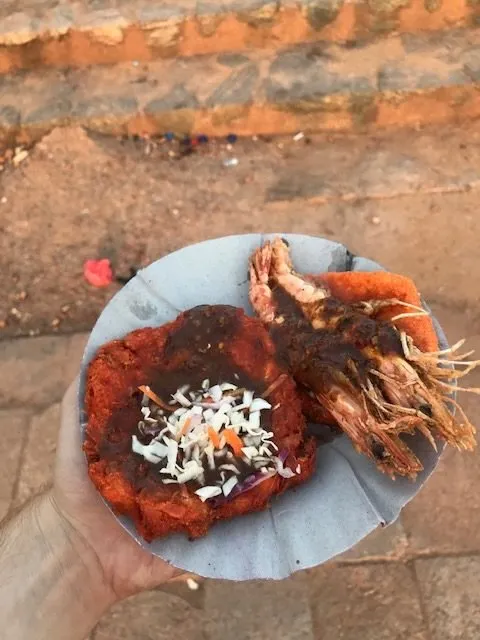{: width="480" height="640" loading="lazy" }

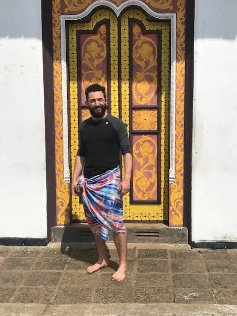{: width="480" height="640" loading="lazy" }

{: width="480" height="640" loading="lazy" }

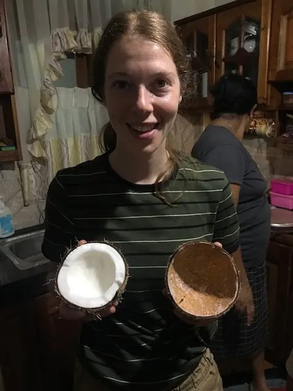{: width="480" height="640" loading="lazy" }

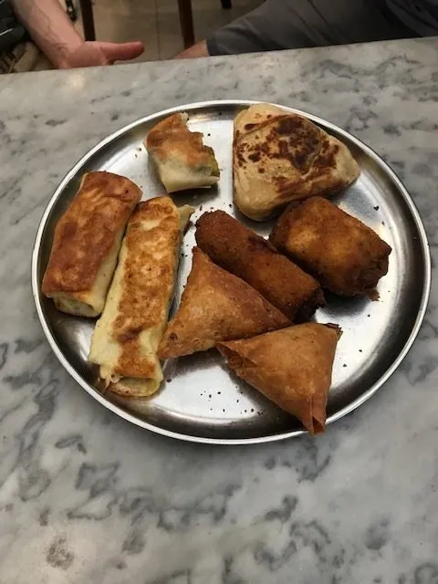{: width="480" height="640" loading="lazy" }

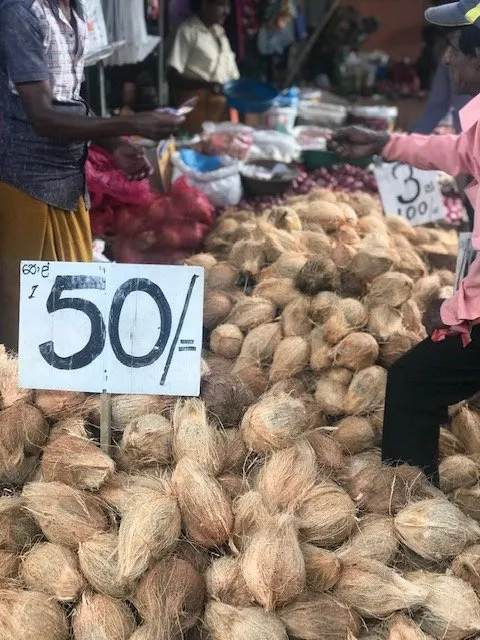{: width="480" height="640" loading="lazy" }

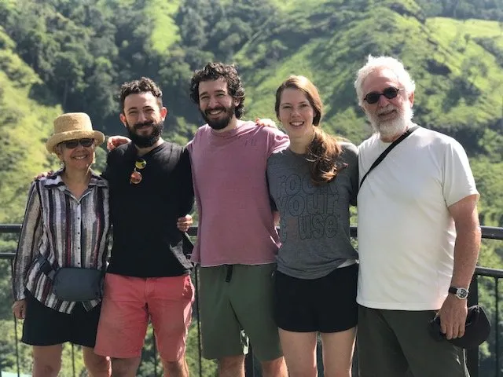{: width="640" height="480" loading="lazy" }

