It’s 700 miles to the Whitsundays. We have a full tank of gas, half a container of vegemite, it’s dark, and we have no idea where we’re staying tonight.

Hit it.

A few months ago, my friend Anna and I decided to make our way up Australia’s east coast. All we had was a tent, a few Spotify playlists, and a 3 day sailing trip booked in around the Whitsunday islands. 10 days to do the 2,200 kilometres there and back meant a lot of driving, but also a great chance to see some of rural Australia.

This part of the Aussie bush isn’t exactly desert and tumbleweeds, instead filled with some beautiful scenery and hilarious characters. As we were camping, some of the places that we got to stay were incredible, and not for your usual reasons:We pitched our tent in the back of a pub in the middle of nowhere and got to see what some of the friendly bogan (read: hick) locals get up to at night. Mostly drinking beer, watching rugby, and seeing how many times in a sentence they could cuss. Also, there was a sign to not disturb the resident frog in the bathroom.For my birthday we stayed at an Airbnb in the middle of Eungella National Park, which is famous for having platypus. The woman who owned the property not only had the biggest, muddiest Maremma Sheepdog named Snowball (or Mudball, after playing outside), but also raised exotic peacocks who would poke their head in to see who the new people were. She was not impressed when Anna asked if they were a breed of bush turkey.A farm we ended up at happened to also be an archery camp. We were there when a club of 60-80 year old’s were having a tournament. Not only did we get to participate in a bit of archery, but we were greeted with amazing hospitality; mostly in the form of Cuban cigars and whiskey older than myself.  Needless to say, we wanted a unique adventure and that’s exactly what we got. And that’s not even talking about the main part of the trip!

Once we made it up to Airlie Beach, the entry to the Whitsundays, we hopped onto a 50 foot catamaran to sail around the beautiful collection of 74 islands that sit on top of the Great Barrier Reef. With 30 other backpackers on board, we quickly made friends and took in the views. With a few snorkels each day, delicious food constantly being made and a few beverages, I couldn’t think of a better way to relax and take in this corner of Australia. Though, it would be a lot nicer if the reef wasn’t mostly bleached.

With new friends and big smiles, we left the boat feeling refreshed, albeit a bit jealous that everyone else was travelling for months more, whereas we had to go back to our 9-5’s. Thankfully we still had a long drive back to get our adventure fix in.

After eventually making it back home, I slowly got back into my routine. I’ve been getting used to my new house (I moved into a place with 4 wonderfully eclectic bohemians; yoga teachers, gypsy jazz musicians, etc.) and have been upskilling my technical prowess at work, navigating the labyrinth that is Excel and PowerBI. While there are no more trips planned for the next while, mostly because I’ve been using up all my days off, I’m still hoping to keep things exciting and interesting while I’m still living down under.

As always, I’d love to hear how things have been going with you!

Zev

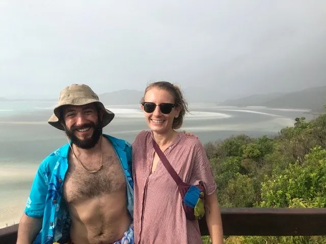{: width="640" height="480" loading="lazy" }

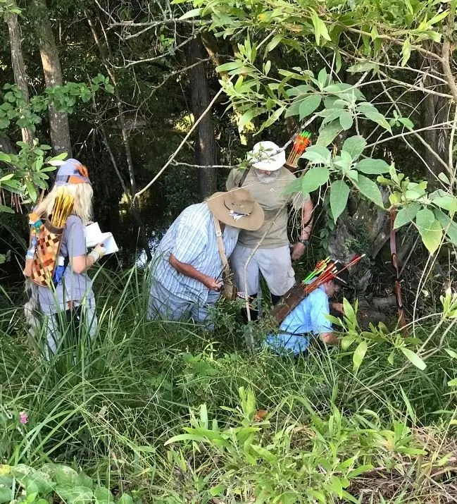{: width="649" height="715" loading="lazy" }

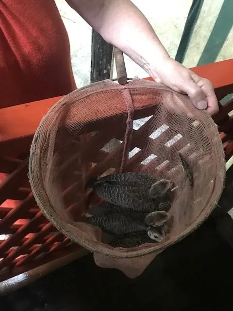{: width="480" height="640" loading="lazy" }

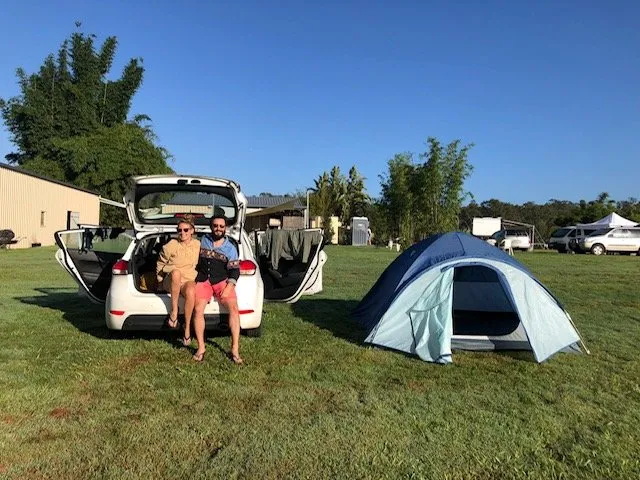{: width="640" height="480" loading="lazy" }

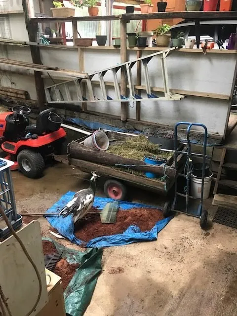{: width="480" height="640" loading="lazy" }

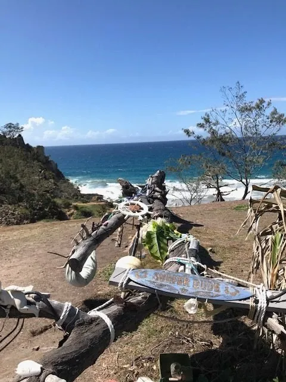{: width="480" height="640" loading="lazy" }

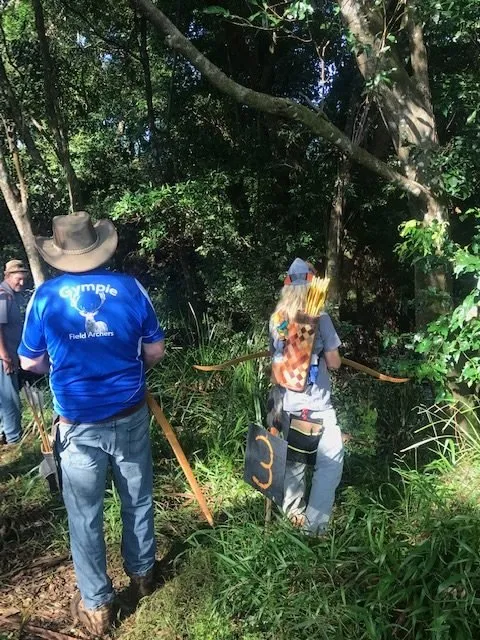{: width="480" height="640" loading="lazy" }

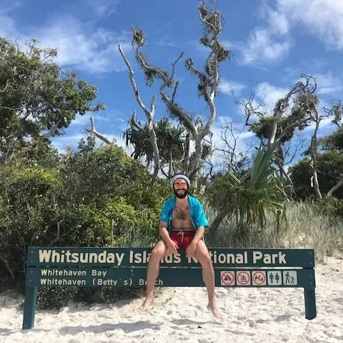{: width="640" height="480" loading="lazy" }

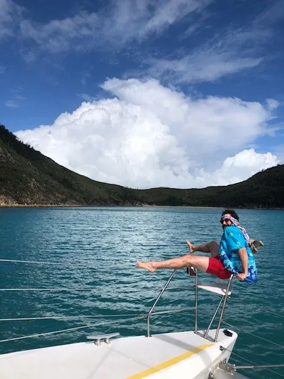{: width="480" height="640" loading="lazy" }

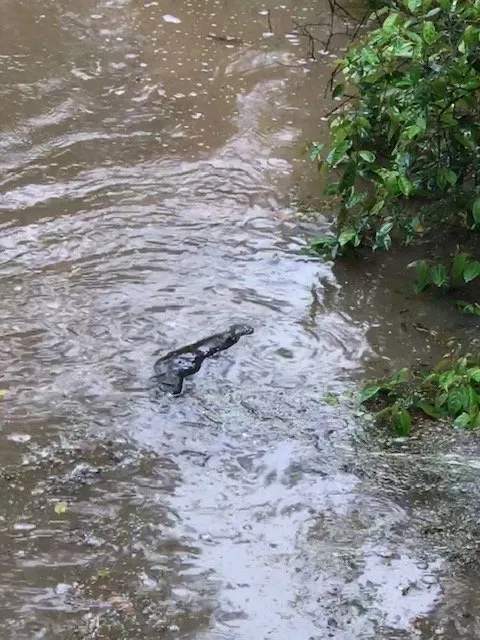{: width="480" height="640" loading="lazy" }

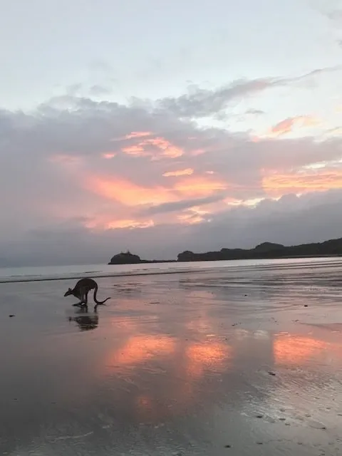{: width="480" height="640" loading="lazy" }

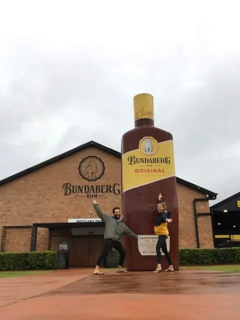{: width="481" height="640" loading="lazy" }

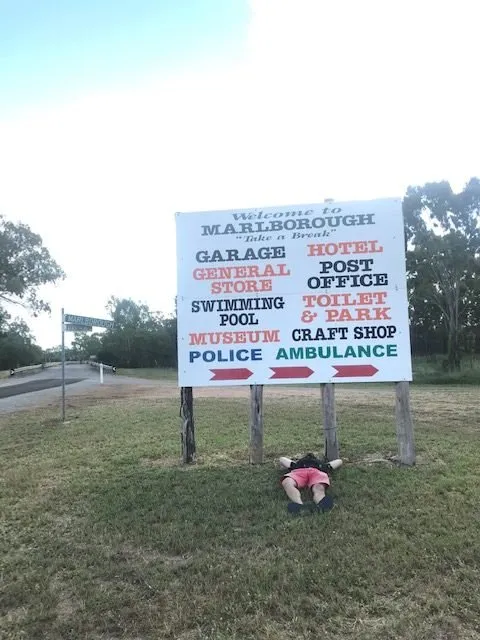{: width="480" height="640" loading="lazy" }

