I’ve fallen in love.

It’s my first time, and what I think will be my last, as I have truly found the one.

Now I know that some of you may not approve as it’s not exactly traditional, but guys, let me tell you that this is serious. I don’t know what bit me, but I just can’t stop thinking about her.

She makes me so happy.

Her name is Kune, and she oinks. Because she’s a pig. You know, like, literally.

The fattest, most bumbly piggy I’ve ever met, and she’s adorably hilarious.

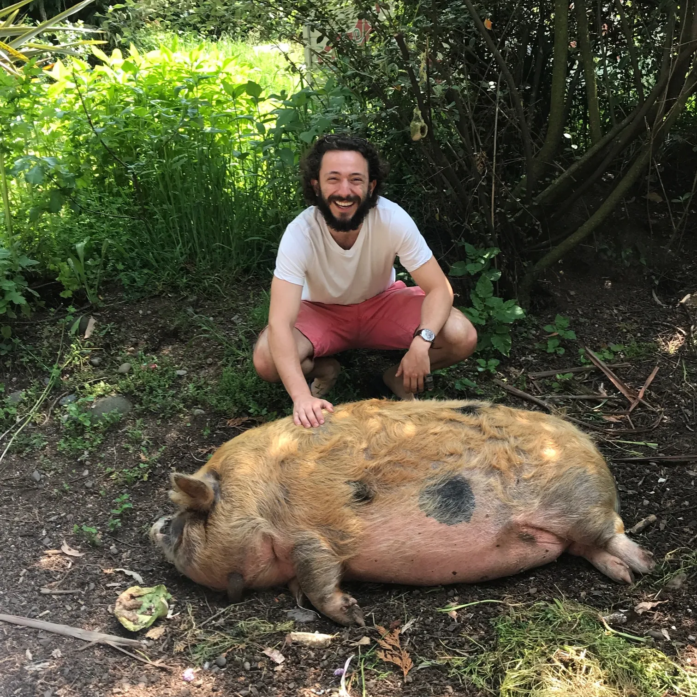{: width="1512" height="1587" loading="lazy" }

Let me give you some backstory.

For the month of November, I asked my boss if I could work remotely from New Zealand. Surprisingly, he said sure! Of course, when an opportunity like that comes around, I jump at it, and set out a plan to make the most of my month in the land of the Kiwis.

While I knew I wanted to travel the whole of New Zealand at some point, I decided on only doing the North Island for this trip. As I’d be working throughout, I figured the North Island was more digital nomad friendly with big cities like Auckland and Wellington. The South Island could wait until I had time to _travel_ travel, instead of spending my days in front of a computer.

New Zealand has long fascinated me. Seeing friends’ photos of the breathtaking landscapes and watching the movie Hunt for the Wilderpeople (would highly recommend), NZ seemed like a mountain man’s paradise filled with some [hilarious people](https://gmail.us3.list-manage.com/track/click?u=001a1df06423a9d1c166f620e&id=1254433b33&e=bffb1d6c72) and an excess of sheep. I knew I’d be in for an adventure and decided to book my flights going into Auckland and out of Wellington, covering as much ground as I could in the interim.

Landing in Auckland around 1am, I was smiling the entire bus ride to the city. While tired, I love the feeling of a new country. Especially one I’ve been dreaming about for years.

The next few weeks were filled with lots of driving, fantastic people, and the beautiful landscapes I’d been promised. Also, a funny story here and there:

Story 1

My first night I got to my hostel at 2am. I was told there’d be a key left for me at the front desk. As adventures tend to go, there was no key. While a bit of a set back, I couldn’t help but laugh at how of course this had happened to me. Still smiling!

That night was spent on the couch, and come morning, there were some very confused breakfasters wondering who the homeless guy was sleeping out in the common room.

It’d turned out that a French-Canadian girl who’d gotten there an hour before me hadn’t let the hostel know she’d be coming in late. As she was in need of a bed, she saw my key and went for it.

Hope you enjoyed your sleep you Francophone bastard (Just kidding! She turned out to be lovely and we had a laugh about it the day after).

Story 2

On my drive to the middle of nowhere for a white-water rafting tour, my rental car’s check engine light decided to come on. After a quick google, my first thought was it must be a silly issue, like a popped fuel cap. However, when I couldn’t get the accelerator to go past 60, I knew I had a problem.

I called up the rental car’s roadside assistance and had a guy out to me in 20 minutes. After some back and forth with the agency and a fun conversation with the tow guy (he told me for fun he hunted wild boar. He’d bring a pack of dogs to the forest to find and hold down the pigs, and then tackle it with his knife. Crazy!!), the decision was to tow me all the way out to the rafting lodge and bring me a replacement car the day after.

An hour and a half of one-way gravel roads later, I was happily at the lodge. With all the staff watching and wondering how the heck a tow truck made it down the tumultuous driveway, I profusely thanked the driver and sent him on his way.

Great customer service, and it didn’t cost me a cent!

Story 3 (The most important)

With plans to do the famous Tongaririo Crossing, a 20km day hike, my Scottish friend Emel and I found a cute organic farm to stay at for a few nights. Filled with WWOOFers (farm hands who work in exchange for food and accommodation) and the best stars I’d ever seen, the farm was a beautiful breath of fresh air.

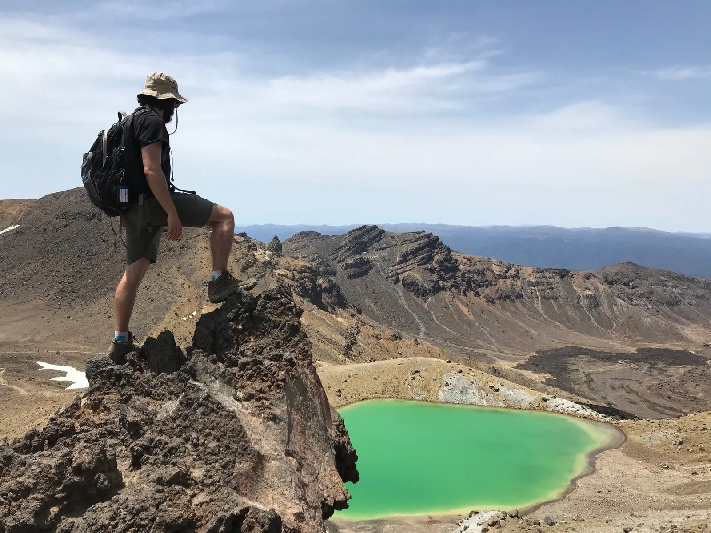{: width="1600" height="1200" loading="lazy" }

Emerald Lake. Halfway through the Tongariro Crossing

Even better were the animals, Honey and Kune. Honey was the farm dog, who got jealous any time you didn’t pay attention to her, constantly swatting at my leg to get pats. Unfortunately for Honey, my pat quota was reserved for Kune.

Kune had wandered onto the farm two years ago as a tiny little piglet, and had been eating everything in sight ever since. Aptly named, Kune is a Kunekune pig, which in Maori means fat and rotund. Which she most definitely was.

While it took her a good 5 minutes every time she wanted to stand up, watching her walk around the farm was a hilarious activity, oinking, tooting, and squealing with every step.

While I only got to spend a few days with her, she had my heart, and I think was my favourite part of the entire trip.

Besides those stories, getting to explore Hobbiton, mountain biking in Rotorua, and doing the Tongariro Crossing were all incredible experiences. Alongside meeting some fantastic people, New Zealand was an awesome adventure and I can’t wait to go back for the South Island.

For those of you wondering, I actually did get a lot of work done on the trip! Not to mention the 1-3am meeting I had every Wednesday night (oh the joy of time zones and global meetings). If the opportunity ever comes up, remote working is a beautiful thing. Especially if you get the chance to do it in somewhere as special as New Zealand.

Wherever you are in the world, I hope you enjoyed some fantastic holidays and that you’ve been up to some adventures yourself! As always, I’d love to hear about what you’ve been up to.

Thanks for reading and all the best in the new year (and new decade!).

Zev

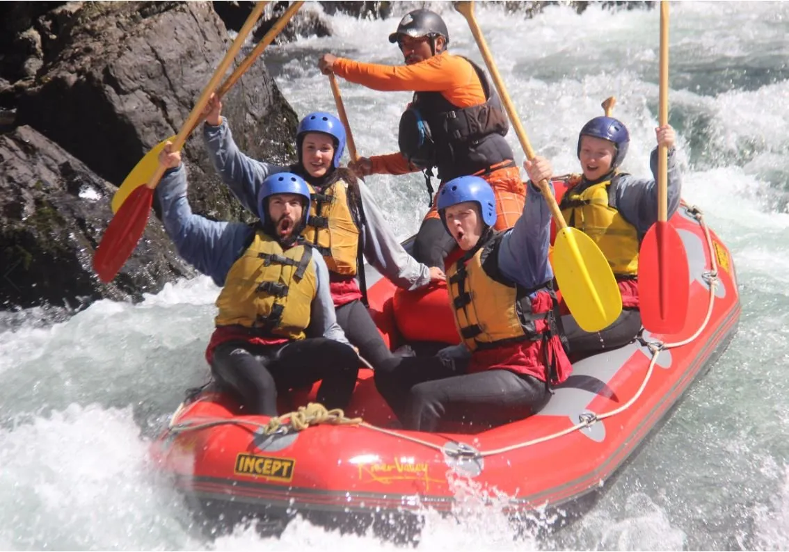{: width="1134" height="794" loading="lazy" }

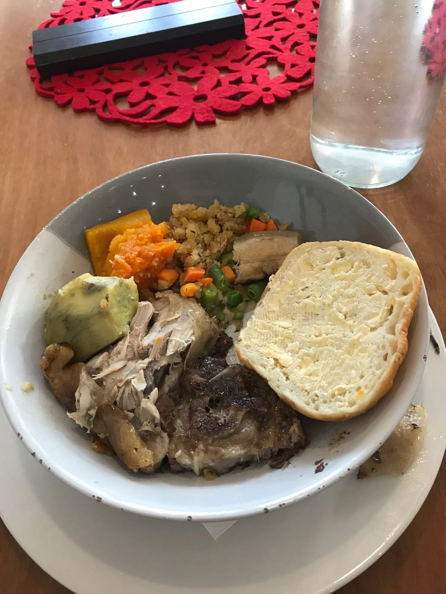{: width="1500" height="2000" loading="lazy" }

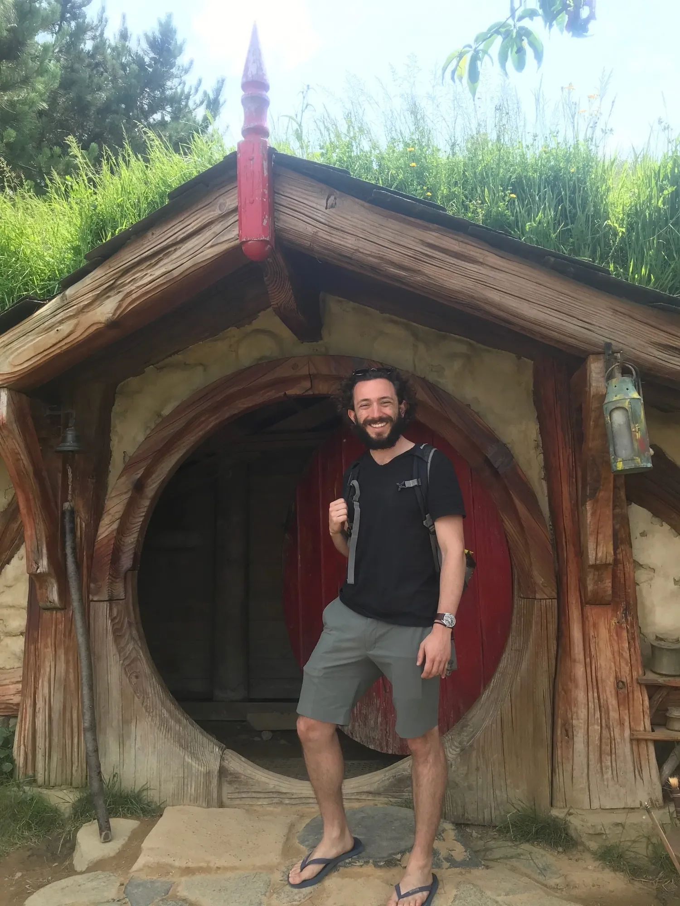{: width="1500" height="2000" loading="lazy" }

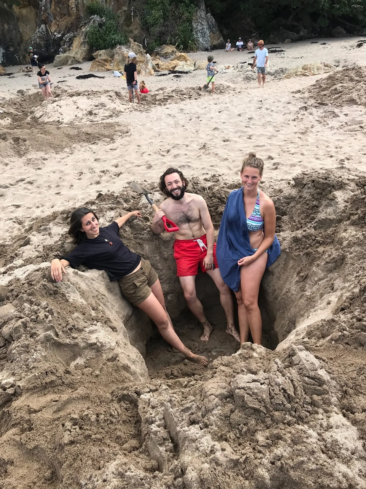{: width="1500" height="2000" loading="lazy" }

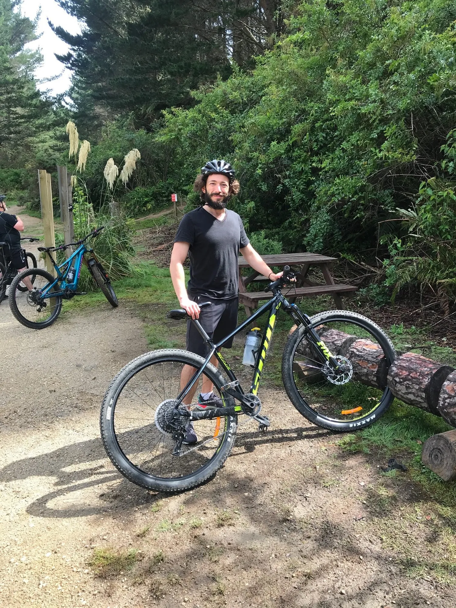{: width="1500" height="2000" loading="lazy" }

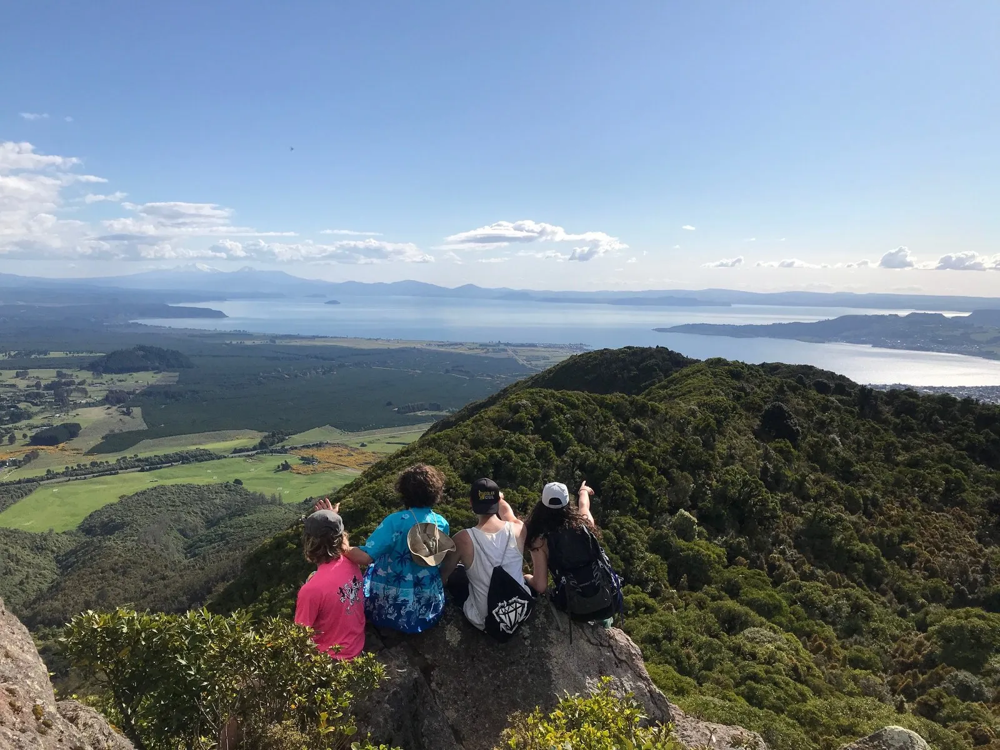{: width="1600" height="1200" loading="lazy" }

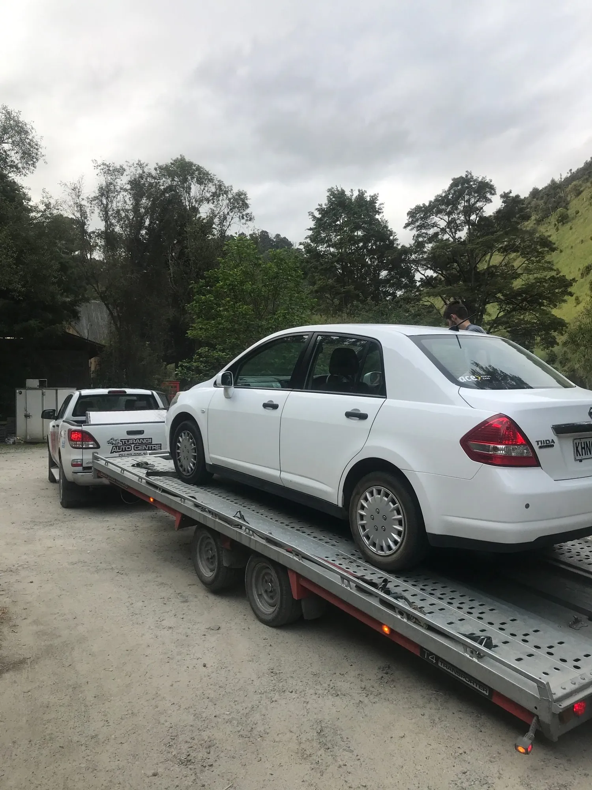{: width="1500" height="2000" loading="lazy" }

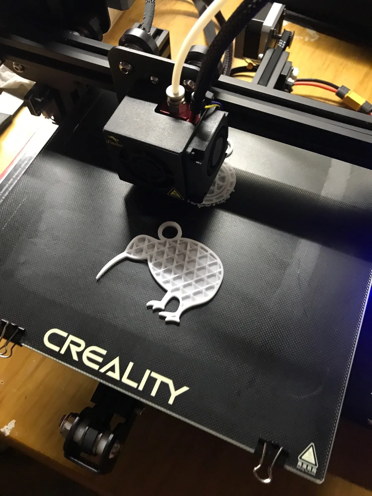{: width="1500" height="2000" loading="lazy" }

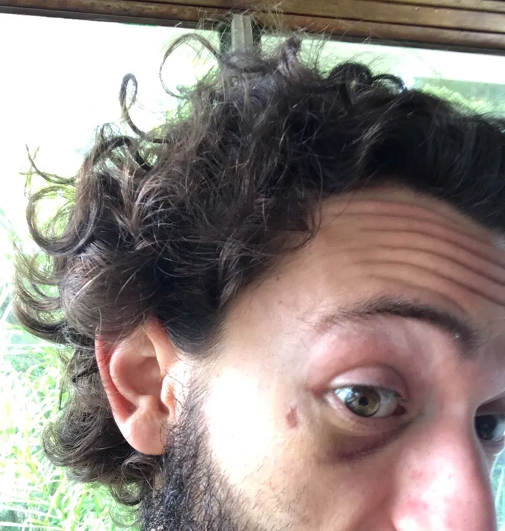{: width="720" height="757" loading="lazy" }

Bonus story: day 2 in Auckland I was staying with a Couchsurfer on her bus. She invited me to a Russian street fighting class, and while I had no idea what that meant, I couldn’t really say no as it sounded awesome. As a result, I proceeded to get my butt absolutely whooped. Pretty cool black eye though, eh?
