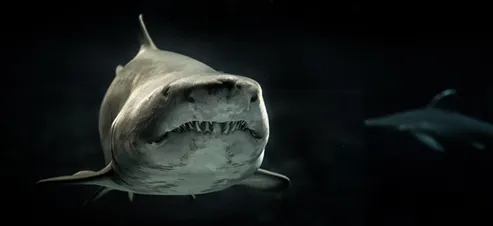
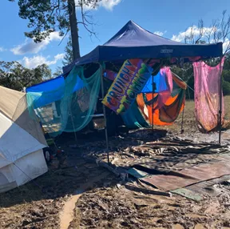
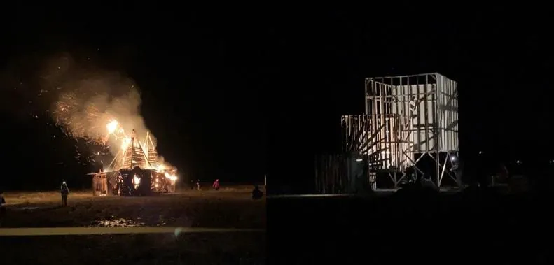
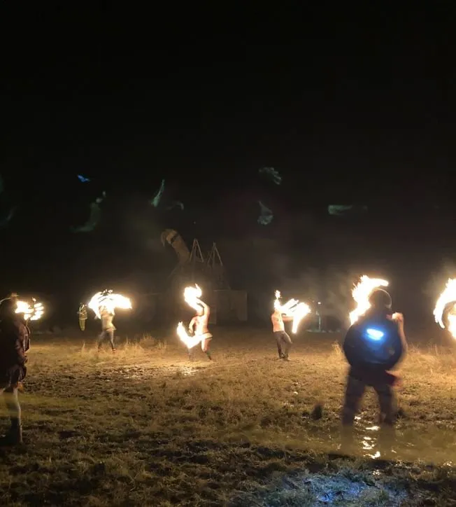
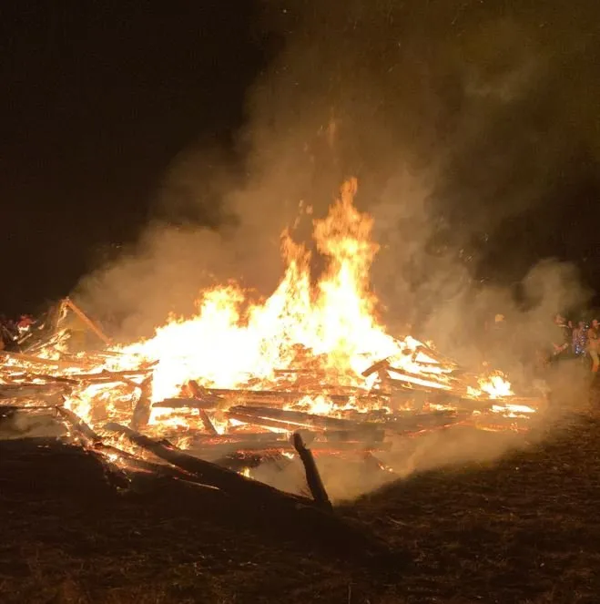

Hello my dear friends, family, and faithful newsletter readers.

I know you’re probably interested in the naked hippies as per the title, but first, some life updates.

Work has continued to be busy and I’m back in the office with a little promotion under my belt. I’m officially working full time in Mergers & Acquisitions!

Besides that, I finally completed my Open Water scuba course.

Breathing underwater has always been high on my list of things to do, but getting my scuba certification at Byron Bay’s Julian Rocks was extra special.

Seeing a turtle the size of a car and so many wobbegongs you had to be careful not to step on a tail, it’s a magical place to explore.

Native animal residents change each season and during the winter you can find the massive grey nurse sharks. On our first dive, and in the first minute, a 15 foot shark came within 10cm of my face!

Presumably to have a little kiss.

{: width="493" height="226" loading="lazy" }

It wasn’t this specific shark but you get the idea
Photo by George Desipris from Pexels

They aren’t harmful, but they sure look terrifying.

Having said that, it was a beautiful way to spend a weekend. Especially after getting rained/flooded out a few months ago on my first Open Water attempt, I’m thankful to finally have my certification in hand.

In other exciting news, I ventured to Queensland’s version of the Burning Man festival.

Going by the name Modifyre, 600 people gather annually in a cow paddock four hours west of Brisbane (i.e middle of nowhere). it’s a week focused on community, creativity, and lighting massive things on fire.

What’s basically a mini city gets constructed during the month prior, getting filled with all things needed to be entertained for the week-long event.

There are theme camps and art installations, but it’s not like a traditional festival.

There’s no set times to watch your favourite artist. There’s also nothing to buy, apart from the inexpensive entry ticket.

Instead, everything is ‘gifted’.

Yes, that means alcohol, food, yoga classes, etc. Gifting is one of the central values of the event, which makes it feel very different to your Coachella or Glastonbury’s.

While you’re expected to be completely self-reliant (another value) for the week in terms of food and water, with neither onsite, if you run out of something you’ll always find a way to get what you need.1

One group roved around town with a tequila cart, handing out shots and happiness. Others drove in a massive bus and set up a DJ booth on the roof. Another camp assembled a shower system (the only one available), blasting Chopin and Bach while you rinsed off the prior day’s dirt. Of course, they named their camp Soap Opera.

Incredibly, all voluntarily.

As it was my first burn I didn’t have any crazy gifts, and instead brought a heap of food to share, played guitar throughout the week, and delivered an impromptu speech when it was called for.

There was always something going on. Including naked hippie mud wrestling.

On the third day, after getting tired of looking at rainy skies, the sun finally decided to show up.

Some free-loving folk decided to use the opportunity to get nude, take a mud bath, and get wrestling in the form of sock wars.

Each person puts on a sock. Last one with their sock on wins.

{: width="288" height="286" loading="lazy" }

The sock wrestling pit. Hippies not pictured (Keeping it PG-13)

As I said…not exactly like Coachella.

The wholesome and hilarious week is completed with the burn of the Bug on Saturday, and the Temple Sunday.

The Bug symbolizes a celebration and results in a massive party, while the Temple is created for reflection and brings the end of the Burn.

Two massive structures that get built for the sole purpose of being burned down.

It’s difficult to put into words, but there’s an amazing power in having 600 people stand around a house sized bonfire, creating atmospheres of both wild, loud fun for the Bug, and quiet contemplation for the Temple.

{: width="791" height="379" loading="lazy" }

The Bug (left) and the Temple (right)

An incredible juxtaposition.

While I can understand it’s not everyone’s cup of tea, I went into it with an open mind and had a great time embracing this new experience with friends both old and new.

Who knows? If I’m back next year, maybe I’ll even throw my sock into the mud pit.

Zev

1The best story of gifting I heard was of the real Burning Man in Nevada, where a common saying is ‘the Playa will provide’, the Playa being the Nevada desert where the event is held. There was a girl on the road, hitchhiking into the festival without food, water, or even a ticket! Solely a watermelon in her arms, and a big smile. No one knows how, she was seen again in the festival a few days later. Now at half a watermelon in her arms, but still, a big smile.

{: width="652" height="724" loading="lazy" }

{: width="659" height="663" loading="lazy" }

