It’s 3am in Killarney Provincial Park.

The waves lightly lapping against the beach where our canoes are stored.

A gentle brightness from the moon, shining over the outdoor adventure underway.

However, all is not peaceful.

We knew there were bears in the park.

Sure to bring bear spray and move our heavy-duty food barrel away from our camp, we were taking what we felt like were the necessary precautions.

After all, we were 4 handsome, athletic young men. Of course we could take on whatever troubles came our way.

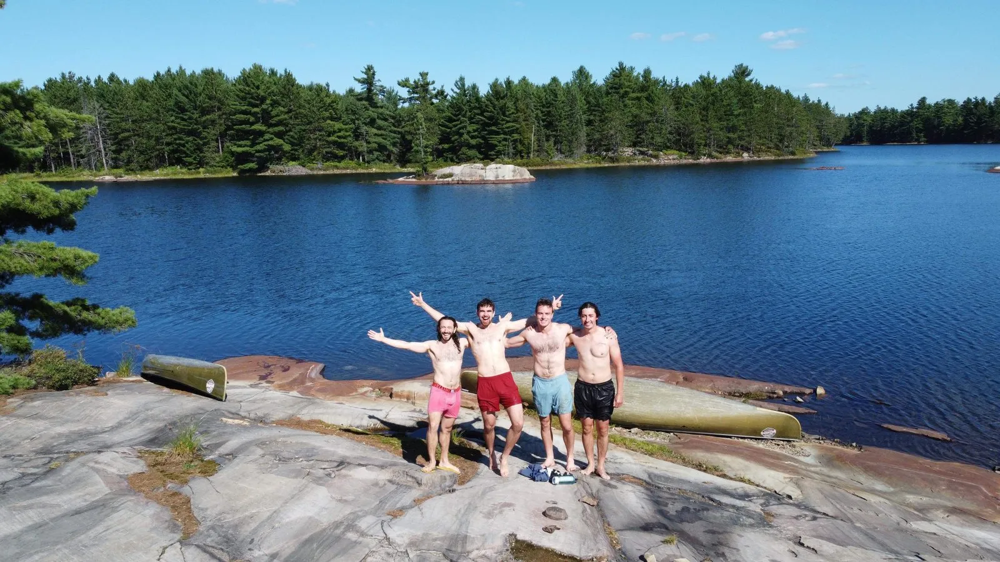{: w="1600" h="900" }

Objectively Handsome, Athletic Young Men

I had just watched the series ‘Alone’. It’s a reality show where contestants are placed somewhere extremely remote, and battle hunger, loneliness, and the environment, competing to survive the longest.

The season I watched, they’re based on Chilko Lake, British Columbia. Serious backcountry, with bears greeting every contestant. With tried and true techniques, they were able to scare off the grizzlies, although there were some close calls.

Watching this show is why I knew exactly what to do when faced with danger.

In a sleepy-eyed dreamy state, I feel something nuzzling me through the tent.

There’s a deep groan that sounds unmistakable.

I shoot up, now wide awake.

“GET OUT OF HERE BEAR!”

Everyone in our party is now well awake. Steve, who’s in the tent with me, and Ed and Tom who are a few feet from us.

“Woah what’s going on? Is everything okay?” we hear from the other tent.

Steve turns to me and after a few moments goes “dude, relax it’s all good”.

After thinking it over, I’d realized that it was Steve’s knee nudging my chest, and he was the one who made the groan.

Oops.

 “Yep all good boys, nothing to worry about”, Steve said to the other tent, before going back to bed.

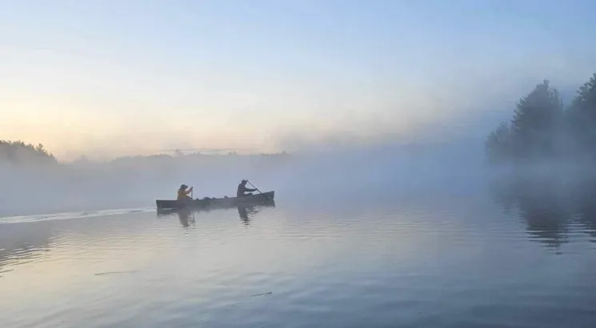{: w="745" h="411" }

Some tasty looking bear snacks in that canoe

Waking up bright and early we recapped what had happened last night. While hilarious for Steve and I, we realized that we didn’t tell the other tent what had actually gone down.

They were under the impression I heroically scared off a lumbering grizzly, but were understandably still nervous about it being near our campsite throughout the night.

Big oops.

It was interesting to look at Ed’s smartwatch which showed his heart rate jolt up in the middle of the night, only reaching it’s base again hours later.

The rest of the trip was as excellent as it could have been.

I had attempted to plan out a difficult canoe trip for us, booking our campsites a challenging distance away for each day.

However, by accident, I hadn’t factored in that ‘challenging’ in my mind was from memories of my last canoe trip at summer camp, a mere 16 years old.

It turns out that carrying a canoe and 15kg pack for a 2km portage seems impossible as a wide-eyed teenager, but was more than doable for these aforementioned handsome and athletic men.

Four good friends. The food in our packs. The wonderful bliss of nature.

Living the dream.

By way of updates, besides the trip to Kilarney, in August/September I spent a few weeks in Toronto followed by a BC road trip. Both were incredible as I go to spend time with my family, meet my new nephew, and do some unbelievable hiking/rock climbing.

Canada’s an amazing place to explore and I hope to be back again soon to see more of you, and more of what the country has in store.

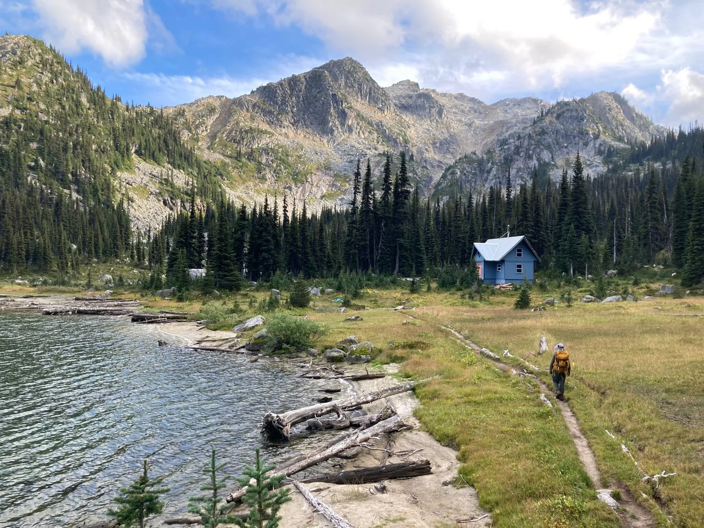{: w="1600" h="1200" }

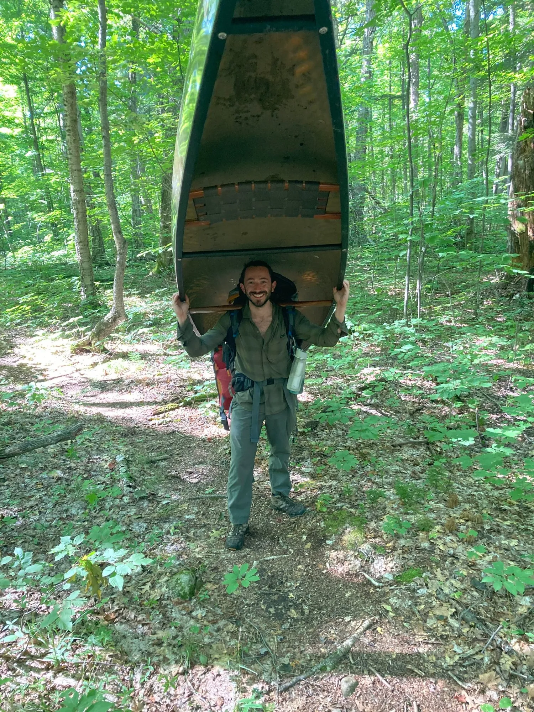{: w="1500" h="2000" }

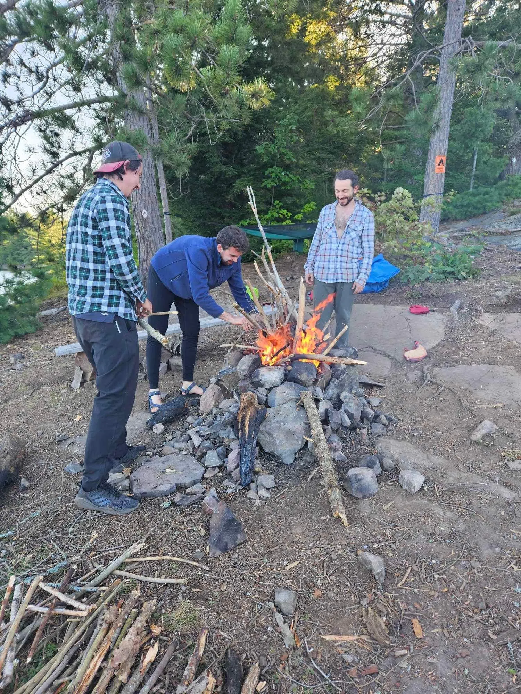{: w="1500" h="2000" }

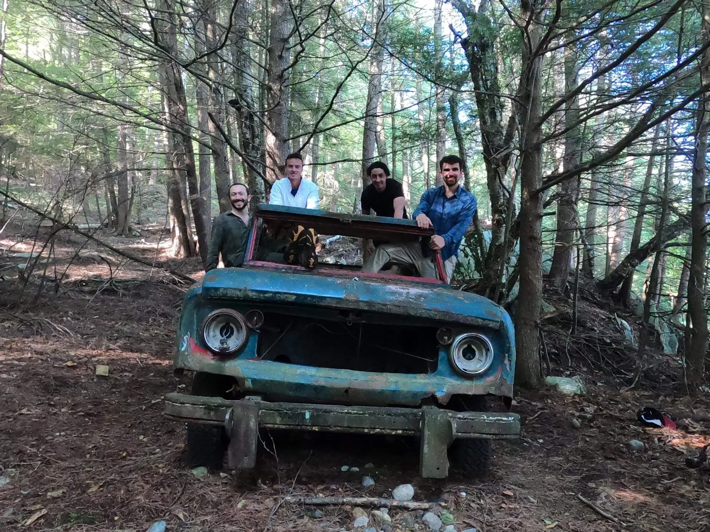{: w="1600" h="1200" }

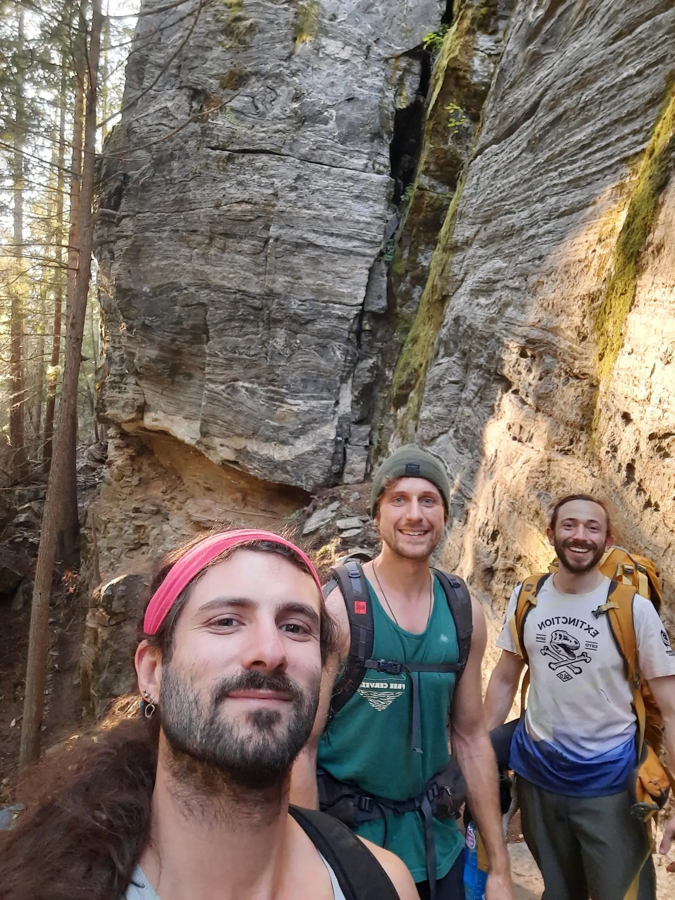{: w="1500" h="2000" }

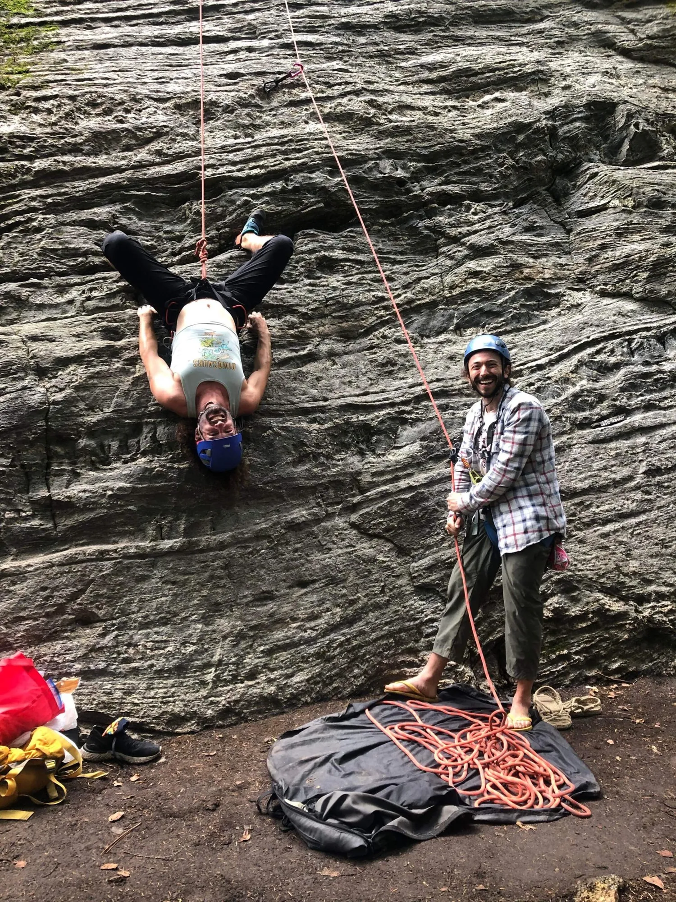{: w="1500" h="2000" }

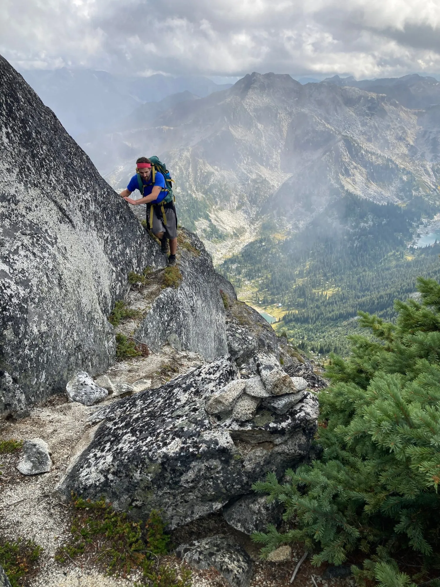{: w="1500" h="2000" }

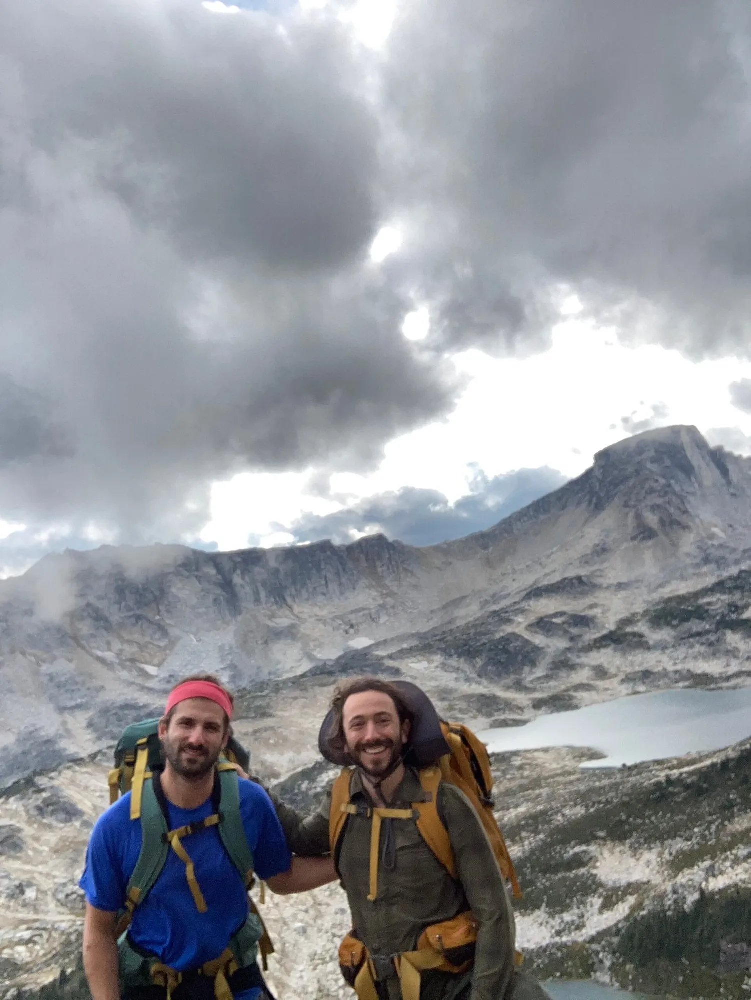{: w="1502" h="2000" }

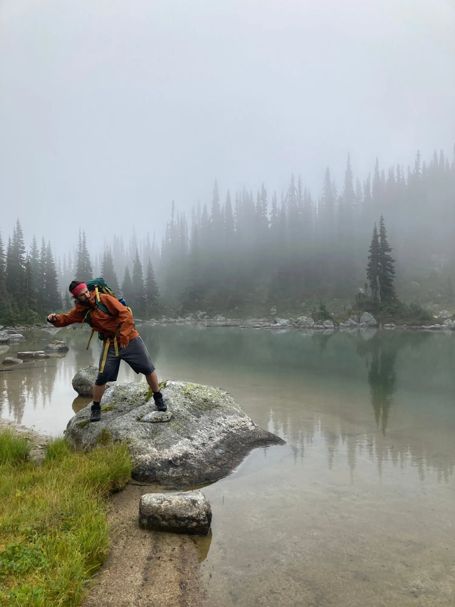{: w="1500" h="2000" }

