There’s something uniquely serene about being naked in a hot tub with 15 Japanese men.

Visiting Japan for a week of skiing and a week of sightseeing, one of my favourite parts was exploring the hot springs, or onsens, that the country has to offer.

Japan’s version of public baths, the onsen is a staple of Japanese culture. Somewhere to relax after a long day, or part of an Après-ski recovery program, these hot springs are an amazing way to kick back.

No one cares if you’re old or young, rich or poor; all\* are welcome at these pools to find Zen or catch up with friends.

All in the nude.

There’s no judgement, except towards the European tourists attempting to cover up with a towel instead of ‘doing as the Roman’s do’.

Each onsen has it’s own mix of pools. Some with varying heat levels, others with several types of jets (lying down, standing up), cold plunges, sulfur pools, indoors / outdoors, etc. I had a great time trying them all out.

Curious to me was a shallow outdoor pool containing 3 rock beds with rock pillows that people were using to nap on their backs. Not the most comfortable, and almost an exhibitionistic way to relax.

Ahhh…serenity.

\*if you have tattoos there are many onsens which won’t allow you entrance unless you can cover them up with a patch

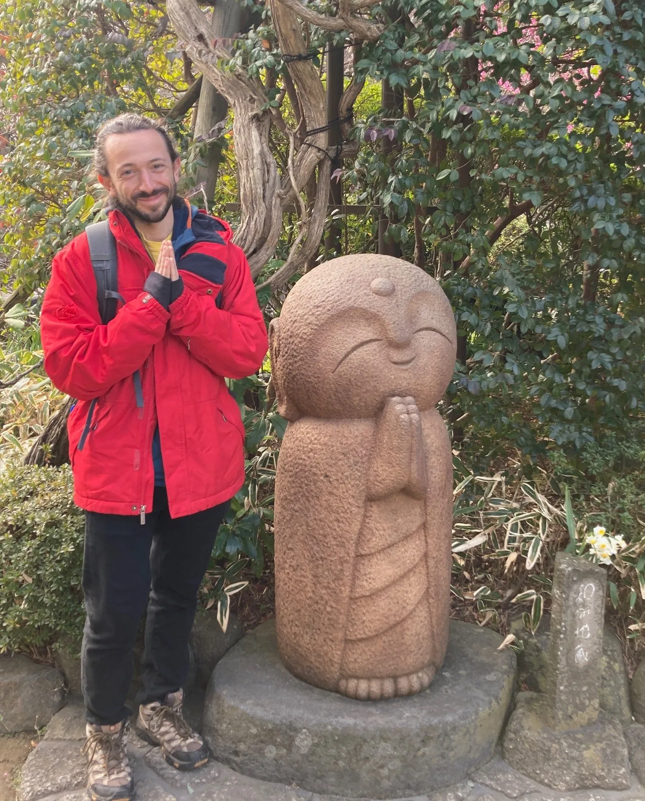{: width="1497" height="1857" loading="lazy" }

Making friends in Zen

Other than fawning over the opportunity to not wear pants in semi-public, Japan was great.

Originally not high on my list of countries to visit, I only have fantastic things to say about this island nation. While we hear in passing about the fantastically planned subway systems and the high-tech toilet seats, the country is so much more than that.

I found Japan’s culture to be an incredible mix of hospitality and collectivism.

Where this shone through was riding on Tokyo’s metro. Rode by millions daily, the train cars remain spotless, and the riders proceed with care for their fellow human. There’s no kids running up and down the aisle, an absence of people talking loudly on their phone, nary a stray crumb from an afternoon snack.

When the Japanese go about their lives, they do so without causing disturbance to others. This was a feeling I got throughout Japan which I really appreciated.

While we’re not exactly brutes in Australia or Canada, the harmoniousness emanating from the Japanese walk of life was something different.

Speaking of uniqueness, the snow! Japan gets snowfall dumps like no other, and is apparently the only place in the world that under-reports the amount of white fluffy precipitation they receive.

Myself and 8 friends were based in Niseko, 2 hours out from Sapporo. Exploring the 4 areas of Niseko and doing a day trip to Rutsusu (my favourite day of snowboarding ever), I spent the week doing 95% off-piste runs, carving through trees and hiking through snowy backcountry.

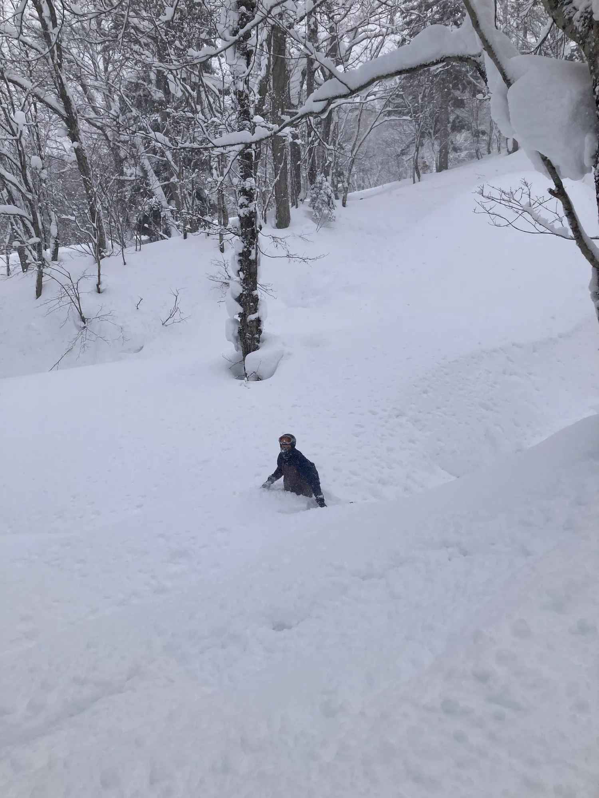{: width="1500" height="2000" loading="lazy" }

My friend Rowan after snowboarding into a hole

The most picturesque run we did involved 3 chairlifts to get to the top, the last being my favourite; the rickety single Pizza Box Chair.

After the final chair drops you off, there’s then a 20 minute hike to the peak of the mountain, where you access three gates leading to the backcountry skiing.

Surprisingly popular, a conga line of hikers forms, and stretches all the way to the top.

When finally there, you get a 360 degree view of the neighbouring mountains and some gnarly triple black runs for the powderhounds.

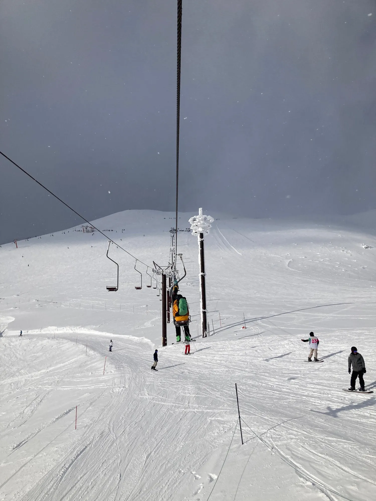{: width="1500" height="2000" loading="lazy" }

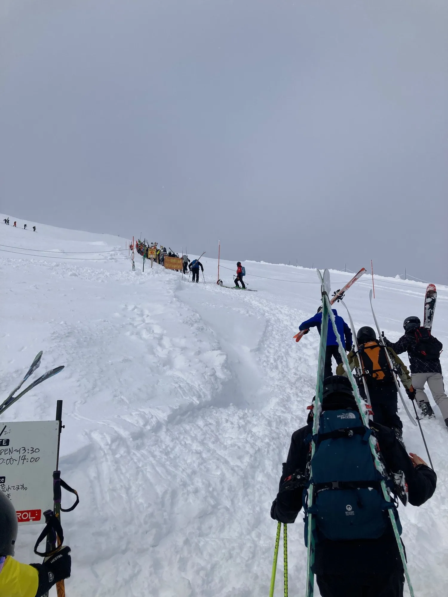{: width="1500" height="2000" loading="lazy" }

Doing the hardest slope as my first run in 5 years likely wasn’t the smartest move, but it was good fun, so no regrets.

Thank you Japan for the great trip. I can’t wait until the next time I’m back.

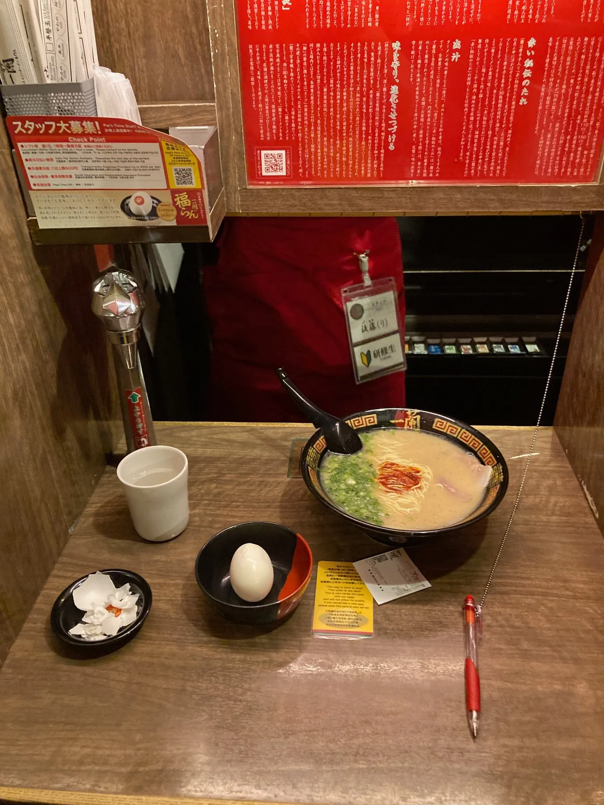{: width="1500" height="2000" loading="lazy" }

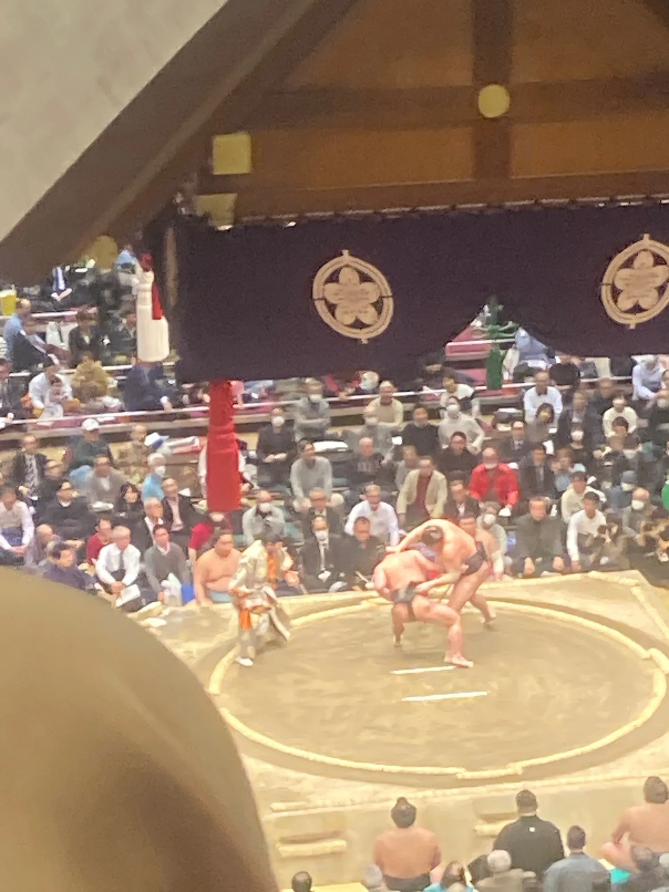{: width="1500" height="2000" loading="lazy" }

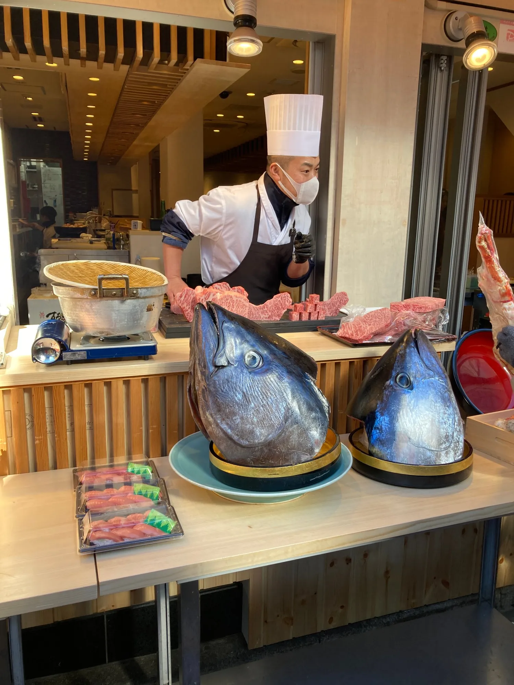{: width="1500" height="2000" loading="lazy" }

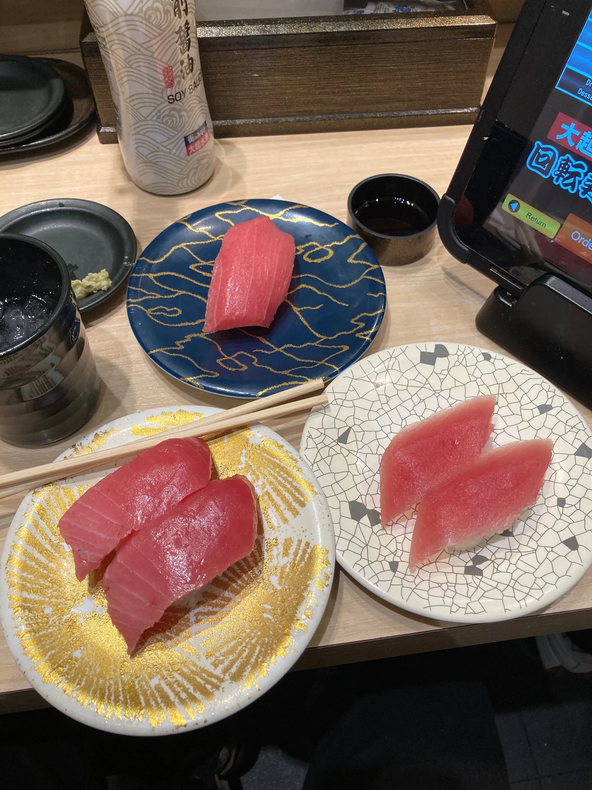{: width="1500" height="2000" loading="lazy" }

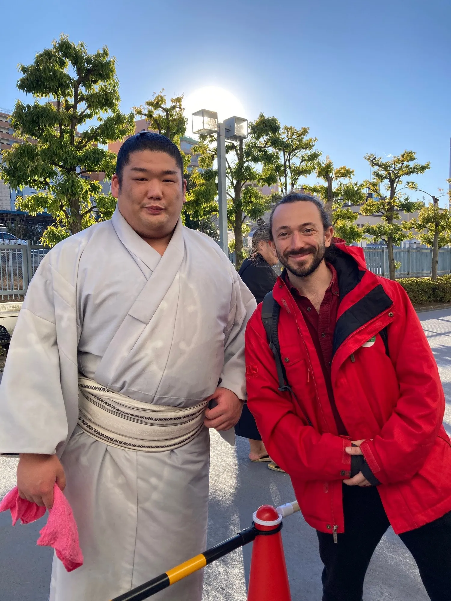{: width="1500" height="2000" loading="lazy" }

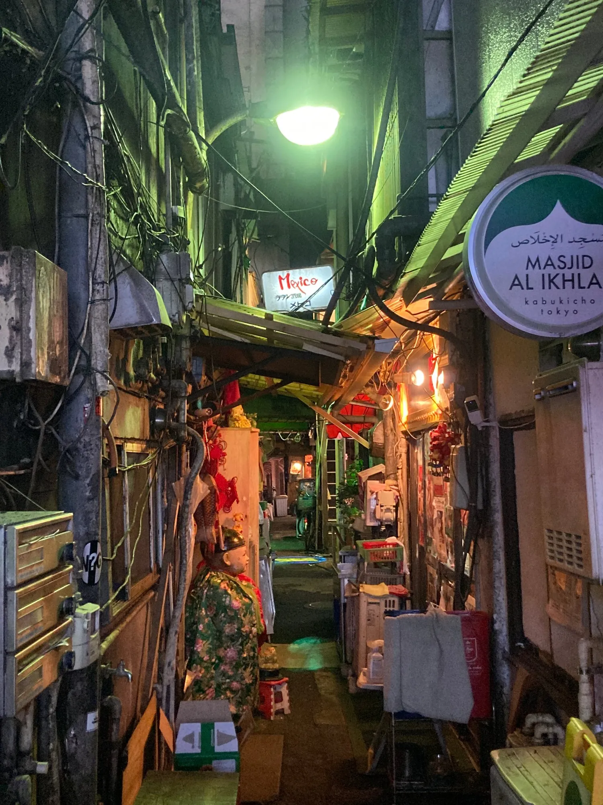{: width="1500" height="2000" loading="lazy" }

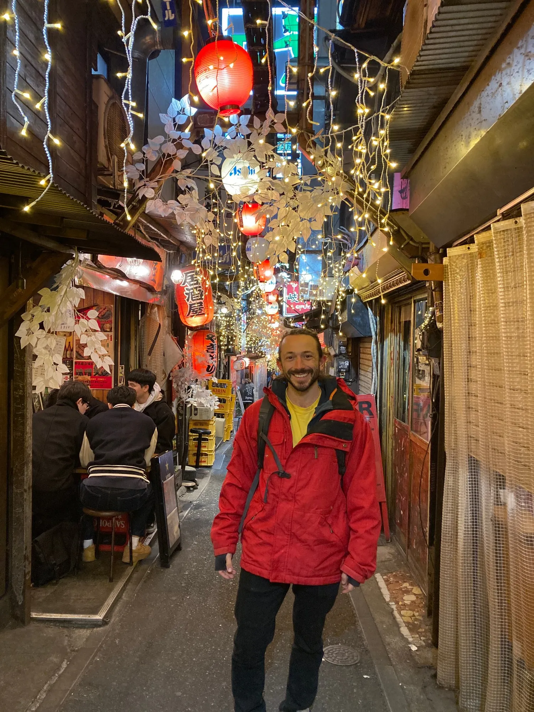{: width="1500" height="2000" loading="lazy" }

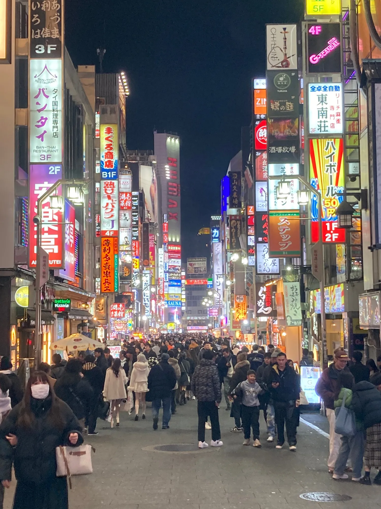{: width="1500" height="2000" loading="lazy" }

