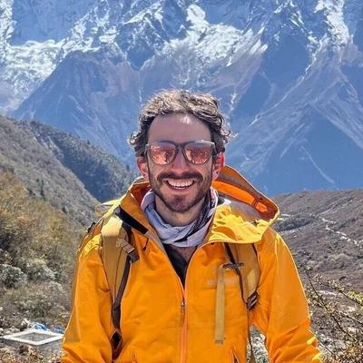

{: .about-photo width="220" height="220" }

I’m Zev. But some of you might know me as Jeff.

Hi there and welcome to my site!

I’m from Canada and I love to travel. Moreover, my passions lie in meeting people and experiencing other cultures. Traveling from a young age with my parents, I’ve found that the more I experience the world, the more I realize that there’s so much to see, and sadly only so much vacation time.

While food and adventure are two of my favourite things, the main reason I travel is for the people. With thousands of cultures around the world, I love learning a new perspective or the different way that someone grew up. I’m a firm believer that I have something to learn from everyone, especially as I’ve found that the quirkiest people always have the best stories to share.

My hope for this site is to highlight all the things I love about travel, focused around the people that I meet. I truly think that strangers are just friends you haven’t met yet, and that everyone has a great story to tell. Whether it’s where they’ve been, or where they’re going, I’m listening!

My goal is to meet someone new everyday. Whether that means on the bus, in the bar, or even sometimes on the street, I’m going to do my best to not pass up the opportunity to meet someone interesting. If they become a friend, fantastic! If they are a simply passing through as a part of my story that works too. I’d like to use this blog to share a small piece of their story. Hopefully it will encourage you to get out and say hi!

## Strangers Used to Terrify Me

I used to absolutely hate meeting people, as I was born with a lisp. Saying “Hi, my name is X” is something most people have no problem with, but with a name like Zev Samuel Skolnik, I was mortified and shy at having to explaining what my name was over and over. 95% of the time introducing myself, I’ll get a confused look, and a guess as to what I just said.

I’ll often get Jeff, Shev, Lev, Seb, Jeb, or Seth. Twice people have called me Kevin. I’m not sure if my parents were playing a practical joke on me as a child, but Z.S.S are pretty funny initials for a kid with a lisp.

While that basic introduction used to keep me from meeting people, way back in high school I had a major turning point. I wanted to be the Vice President of the student council, and as a result had to give a 3 minute speech in front of the 700+ student body. While terrifying for someone with no public speaking experience, I knew that this was something I wanted to do.

Writing my speech, I decided to use what I thought was my biggest weakness to my advantage. On the day of the speech, as I sat there nervously listening to the other candidates, I was finally called up to the podium.

Trembling as I walked up to the mic, I unfolded my speech and began…

“Some of you might know me in the halls as Jeff, Seb, Seth or one person even called me Kevin. I’m here to clear up that story. My name is Zev Samuel Skolnik. While that might be the worst possible name in history for a kid with a lisp, I think it’s a fantastic name for your next Vice President.”

From that moment, I had everyone laughing and having a great time. My nerves slowly dissipated and the rest of the speech flew by.

I finally realized that my friends and teachers don’t care if I have a lisp. They care about my ideas, my friendship and my good company.

That was the moment I began to look forward to the inevitable conversation surrounding my name. The moment I became a much better equipped globetrotter.

## Growing Up

Throughout my years, I’ve been extremely fortunate to see some of the world with my parents. Every year, we would go to a variety of countries exploring South and Central America and the Middle East. Looking back, I’m extremely thankful for the opportunities I’ve had to hop on a plane from a young age and be instilled with a sense of adventure.

While my family and I have gone on a few all-inclusive vacations, we found that all of our best experiences were off the beach. Exploring the cities and nature, our goal was always to find the best local things to do. Whether that meant seeing the Bueno Vista Social Club play jazz in Cuba, snorkeling with hundreds of nurse sharks and sting rays off a catamaran in Belize, or paddling down the Pacuare River rapids in Costa Rica, each adventure was better than the next.

While we would always end up arguing over who took which amazing photo, the memories are some I’ll never forget. I couldn’t be luckier for having such incredible opportunities as a kid, so a big thanks to my Mom and Dad.

## Why Did I Start This Site?

I’m looking to share some of my travel stories, guides and adventures with the world. I really enjoy writing (have kept a journal for every big trip I’ve been on) and thought a blog would be a great next step to continue to write.

Hopefully some of what I write helps other people with their travels.

So, welcome and happy reading! Especially if you’re also not Jeff.

## Stay in touch

Want the next story in your inbox?



Or say hi at [hello@nonotjeff.com](mailto:hello@nonotjeff.com).
